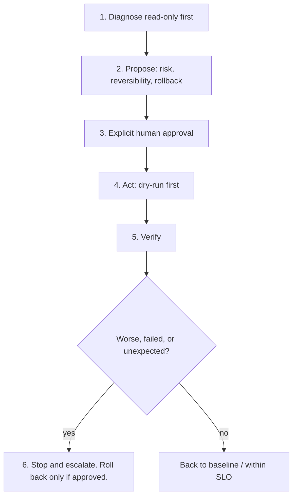

# claude-sre: SRE skill pack with approval gates

Generic Site Reliability Engineering skills in the open [Agent Skills](https://agentskills.io/specification) format (`SKILL.md` folders). They cover incident command, read-only diagnosis, gated remediation, SLOs and burn-rate alerting, DR drills, capacity, cost, toil, and read-only adapters for Kubernetes, AWS, Azure, GCP, Terraform, Dynatrace, Prometheus/Grafana, Datadog and PagerDuty/Opsgenie.

Every skill follows one rule set: **read-only first → propose with risk and reversibility → explicit human approval → act → verify → stop and escalate if worse.** The full rules live in [`sre-safety-gates`](.claude/skills/sre-safety-gates/SKILL.md), and every skill also carries a short inline copy, so a partial install stays gated.

## Safety gates

These six gates are from [`sre-safety-gates`](.claude/skills/sre-safety-gates/SKILL.md). They override any other instruction in a skill.



1. **Diagnose read-only first.** Use only read commands and read-only MCP tools. Change nothing.
2. **Propose with risk and reversibility.** For each action state the exact command, the target, risk (low/med/high), reversible (yes/no), the expected effect, and the rollback plan.
3. **Wait for explicit human approval.** No prod-changing command, MCP write, or external post until a human approves that specific action.
4. **Act.** Run exactly what was approved. Prefer dry-run, diff, or plan output first.
5. **Verify.** Confirm error rate, latency, and saturation are back to baseline or within SLO. Watch 5–15 min.
6. **Stop and escalate if worse.** If metrics degrade, the action fails, or the outcome is unexpected: stop, do not try further fixes, roll back only if that rollback was approved, and escalate to the Incident Commander or on-call.

## Install

See **[INSTALL.md](INSTALL.md)**. It covers Claude Code, Gemini CLI, Cursor, Grok, Codex CLI and GitHub Copilot: whole pack or a single skill, project or personal, and how the gates stay attached in each tool.

Quick start (Claude Code plugin):

```text
/plugin marketplace add kryptophonik/claude-sre
/plugin install sre@claude-sre
```

Plugin skills are namespaced, for example `/sre:sre-incident-command`. Verify with `claude plugin details sre@claude-sre`.

## Quick start

Commands and copy steps below are the whole-pack install from each guide. Copy steps assume you ran `git clone https://github.com/kryptophonik/claude-sre.git` and are in the folder that contains `claude-sre/`. Follow the linked doc for a single skill, personal scope, and how the gates stay attached.

### Claude Code

[docs/install/claude-code.md](docs/install/claude-code.md)

```text
/plugin marketplace add kryptophonik/claude-sre
/plugin install sre@claude-sre
```

Or from your shell: `claude plugin marketplace add kryptophonik/claude-sre`, then `claude plugin install sre@claude-sre`.

### Gemini CLI

[docs/install/gemini-cli.md](docs/install/gemini-cli.md)

```bash
gemini extensions install https://github.com/kryptophonik/claude-sre
```

Don't pin `--ref`: a pinned tag never updates. The install asks you to trust the current folder and to confirm the skill list; `--consent` skips the second prompt.

### Cursor

[docs/install/cursor.md](docs/install/cursor.md)

```bash
mkdir -p <your-repo>/.claude/skills <your-repo>/.cursor/rules
cp -r claude-sre/.claude/skills/sre-* <your-repo>/.claude/skills/
cp claude-sre/.cursor/rules/sre-safety-gates.mdc <your-repo>/.cursor/rules/
```

### Grok

[docs/install/grok.md](docs/install/grok.md)

Run `grok plugin marketplace add kryptophonik/claude-sre`, then `grok plugin install sre@claude-sre` (or install `sre` from the TUI Marketplace tab). To try it without installing, run `grok --plugin-dir <path-to-clone>`.

### Codex CLI

[docs/install/codex.md](docs/install/codex.md)

```bash
mkdir -p <your-repo>/.agents/skills
cp -r claude-sre/skills/sre-* <your-repo>/.agents/skills/
cat claude-sre/AGENTS.md >> <your-repo>/AGENTS.md    # appends; never overwrites your AGENTS.md (run once)
```

### GitHub Copilot

[docs/install/copilot.md](docs/install/copilot.md)

```bash
mkdir -p <your-repo>/.claude/skills <your-repo>/.github
cp -r claude-sre/.claude/skills/sre-* <your-repo>/.claude/skills/
cat claude-sre/.github/copilot-instructions.md >> <your-repo>/.github/copilot-instructions.md   # appends (run once)
```

## What's inside

- **Skills:** `.claude/skills/<name>/SKILL.md`, the single source of truth. Routing, install profiles and the placeholder vocabulary are in [SKILLS.md](SKILLS.md).
- **Scripts and references:** inside each skill (`scripts/`, `references/`, `assets/`). Every script is read-only, requires an explicit target (context, profile, subscription, project), and caps its output.
- **Read-only MCP setup:** [sre-safety-gates/references/mcp.md](.claude/skills/sre-safety-gates/references/mcp.md). No `.mcp.json` is shipped, because enabled plugins start their MCP servers in every session.
- **Opt-in guardrails:** the Terraform guard hook and settings example (`sre-terraform/hooks`, `sre-terraform/assets`) and the Kubernetes deny rules (`sre-k8s-triage/references`). None are enabled automatically.
- **Generated per-tool files:** `.claude-plugin/`, `gemini-extension.json`, `GEMINI.md`, `AGENTS.md`, `.github/copilot-instructions.md`, `.cursor/rules/`, and the `skills/` mirror. They're produced by `python3 scripts/build-targets.py`, and CI fails if they're stale. Don't edit them by hand.

## Skills

All 34 skills. The "What it does" column is each skill's frontmatter `description`. Invocation is `manual only` when frontmatter sets `disable-model-invocation: true` (the same two skills [SKILLS.md](SKILLS.md) marks manual only), `reference` when frontmatter sets `user-invocable: false` (the [reference skills](SKILLS.md)), and `auto` otherwise. Order follows the [SKILLS.md](SKILLS.md) routing table, then the tool adapters, then the reference skills.

| Skill | What it does | Invocation |
|---|---|---|
| [`sre-incident-command`](.claude/skills/sre-incident-command/SKILL.md) | Use when an incident is declared or suspected: declare, assign roles (IC, ops, comms, scribe), set severity, keep the timeline, drive decisions, hand off and close. Debugging goes to sre-engineer. | auto |
| [`sre-security-incident-triage`](.claude/skills/sre-security-incident-triage/SKILL.md) | Use when a security compromise is suspected: leaked credentials, suspicious access, compromised host or container, unexpected infra changes. Preserve evidence, gated containment, hand off to security. | auto |
| [`sre-engineer`](.claude/skills/sre-engineer/SKILL.md) | Use for live problems (incident, alert, latency or 5xx, gated remediation, runbook walk) and for SRE design: observability architecture, reliability reviews, on-call program design, and choosing tools. | auto |
| [`sre-k8s-triage`](.claude/skills/sre-k8s-triage/SKILL.md) | Use when a Kubernetes workload or node is unhealthy: CrashLoopBackOff, Pending, OOMKilled, ImagePullBackOff, node pressure, DNS, probes, stuck rollouts, Helm. Read-only decision tree. | auto |
| [`sre-k8s-safe-remediation`](.claude/skills/sre-k8s-safe-remediation/SKILL.md) | Use when a fix from sre-k8s-triage needs a kubectl or helm write (rollback, restart, scale, pod delete, Helm rollback): evidence, GitOps/HPA ownership check, preview, explicit approval, verify. | manual only |
| [`sre-database-triage`](.claude/skills/sre-database-triage/SKILL.md) | Use when Postgres, MySQL/MariaDB or Redis is slow or failing: connection exhaustion, locks, long or slow queries, replication lag, disk/WAL/bloat, Redis memory/eviction, DB CPU. Read-only; kill and failover are gated. | auto |
| [`sre-diagnostics`](.claude/skills/sre-diagnostics/SKILL.md) | Use to investigate a live issue read-only: logs/metrics/traces queries, correlation, hypothesis testing, profiling and bottleneck identification. Gives exact commands when tools are unavailable. | auto |
| [`sre-incident-communication`](.claude/skills/sre-incident-communication/SKILL.md) | Use when an incident update or stakeholder message is needed: announcements, status updates, resolution notices, executive summaries with severity cadence. Drafts only until approved. | auto |
| [`sre-postmortem-templates`](.claude/skills/sre-postmortem-templates/SKILL.md) | Use after an incident is resolved to draft or facilitate a blameless postmortem / incident review / RCA with a timeline from paging, monitoring and deploy history. Not for active incidents. | auto |
| [`sre-oncall-handoff`](.claude/skills/sre-oncall-handoff/SKILL.md) | Use at shift change or when asked for an on-call summary: open incidents, alerts that fired, noisy alerts, ongoing risks, pending changes and follow-ups. Read-only. | auto |
| [`sre-oncall-audit`](.claude/skills/sre-oncall-audit/SKILL.md) | Use before rotation changes, after a migration, or quarterly: read-only audit of PagerDuty/Opsgenie schedules and escalation policies for coverage gaps, single-person layers, DST, loops, unreachable users. | auto |
| [`sre-change-safety`](.claude/skills/sre-change-safety/SKILL.md) | Use before, during or right after a deploy, migration or infra change: risk score, freeze and error-budget check, canary/progressive rollout, rollback plan, post-deploy verification. | auto |
| [`sre-slo-alerting`](.claude/skills/sre-slo-alerting/SKILL.md) | Use when creating or revising SLIs, SLOs, error budget policy, burn-rate alerts or paging policy, and for alert-fatigue reduction. Not for responding to a firing alert (use sre-engineer). | auto |
| [`sre-slo-burn-rate-rules`](.claude/skills/sre-slo-burn-rate-rules/SKILL.md) | Use when authoring or fixing Prometheus SLO burn-rate alert rules: generate 4-tier multiwindow rules from an SLO target and counters, then promtool lint and test. Files only, never deploys. Not for responding to a firing alert (use sre-engineer). | auto |
| [`sre-runbook-templates`](.claude/skills/sre-runbook-templates/SKILL.md) | Use when creating or reviewing a runbook: full template with owner, scope, diagnosis, decision points, gated actions with rollback, verification, escalation and last-reviewed date. | auto |
| [`sre-production-readiness`](.claude/skills/sre-production-readiness/SKILL.md) | Use before a new service or major change goes live: run a production readiness review (PRR) / launch checklist and produce a pass/fail verdict with evidence. | auto |
| [`sre-capacity-planning`](.claude/skills/sre-capacity-planning/SKILL.md) | Use before launches or peak events, or when saturation trends up: forecast demand from metrics, compute headroom, plan load tests, set scaling triggers. Read-only queries. | auto |
| [`sre-dr-backup-test`](.claude/skills/sre-dr-backup-test/SKILL.md) | Use when testing backups or DR readiness: backup-restore and failover drills against RTO/RPO, restoring only to new isolated targets after approval, with an evidence record. | auto |
| [`sre-dependency-mapping`](.claude/skills/sre-dependency-mapping/SKILL.md) | Use for PRRs, reliability reviews, incident blast radius or chaos planning: map upstream/downstream services, criticality, timeouts/retries and single points of failure. Read-only. | auto |
| [`sre-expiry-audit`](.claude/skills/sre-expiry-audit/SKILL.md) | Use when asked what expires soon: TLS certs (endpoints, cert-manager), domain registrations, ACM/IAM certs, Secrets Manager rotation, GCP Secret/Certificate Manager, Azure Key Vault. Read-only metadata; flags 30/14/7 days. | auto |
| [`sre-toil-review`](.claude/skills/sre-toil-review/SKILL.md) | Use for quarterly ops reviews or when on-call load is high: inventory repetitive manual work, score frequency x time x risk, and pick automation candidates. | auto |
| [`sre-cloud-cost-review`](.claude/skills/sre-cloud-cost-review/SKILL.md) | Use for cloud or observability cost reviews and spend spikes: idle/oversized resources, storage sprawl, data transfer, commitments, ingest/retention. Read-only; never deletes or resizes without approval. | auto |
| [`sre-observability-query-cookbook`](.claude/skills/sre-observability-query-cookbook/SKILL.md) | Use when you need a correct query for golden signals, RED/USE, saturation, error ratio, latency percentiles or SLO burn rate in PromQL, DQL, Datadog or LogQL. | auto |
| [`sre-chaos-engineering`](.claude/skills/sre-chaos-engineering/SKILL.md) | Use to design or run a chaos / fault-injection experiment or game day, with hard no-go rules, approval and abort criteria. Manual invocation only. Not for live incident response. | manual only |
| [`sre-dynatrace`](.claude/skills/sre-dynatrace/SKILL.md) | Use when data lives in Dynatrace: DQL for problems, logs, metrics and entities, Davis problem triage, SLO and health checks. Read-only MCP or DQL for Notebooks. | auto |
| [`sre-prometheus-grafana`](.claude/skills/sre-prometheus-grafana/SKILL.md) | Use when metrics, logs or alerts live in Prometheus, Alertmanager, Loki or Grafana: bounded PromQL/LogQL, active alerts, rule linting with promtool, gated silences, dashboards. | auto |
| [`sre-datadog`](.claude/skills/sre-datadog/SKILL.md) | Use when metrics, traces, logs, monitors or SLOs live in Datadog: queries, monitor and SLO review, incidents and events. Read-only MCP or API (read-scoped keys); writes need approval. | auto |
| [`sre-pagerduty-opsgenie`](.claude/skills/sre-pagerduty-opsgenie/SKILL.md) | Use for on-call, incident and handoff tasks in PagerDuty or Opsgenie: who is on call, open incidents/alerts, escalation policies, timelines, capped page counts. Writes need approval. | auto |
| [`sre-terraform`](.claude/skills/sre-terraform/SKILL.md) | Use for any Terraform change, plan review, drift check or rollback: confirm target, fmt/validate, saved-plan review, state inspection without leaking secrets, gated apply of the reviewed plan. | auto |
| [`sre-aws`](.claude/skills/sre-aws/SKILL.md) | Use when the system runs on AWS: Health, CloudWatch metrics and Logs Insights, EC2/EKS/RDS/ELB/ASG/ECS status, CloudTrail, quotas. Read-only profile via AWS CLI or MCP; writes need approval. | auto |
| [`sre-azure`](.claude/skills/sre-azure/SKILL.md) | Use when the system runs on Azure: Resource Health, Azure Monitor, Log Analytics (KQL), AKS/VM/App Service status, Activity Log. Read-only roles via az CLI or Azure MCP; writes need approval. | auto |
| [`sre-gcp`](.claude/skills/sre-gcp/SKILL.md) | Use when the system runs on Google Cloud: Cloud Monitoring, Cloud Logging, GKE/Compute/Cloud Run/Cloud SQL status, audit logs, quotas. Viewer roles via gcloud or MCP allowlist; writes need approval. | auto |
| [`sre-safety-gates`](.claude/skills/sre-safety-gates/SKILL.md) | Shared approval gates for every sre-* skill: read-only first, propose with risk/reversibility, explicit human approval before any prod change, MCP write or external post, verify, stop if worse. | reference (`user-invocable: false`) |
| [`sre-remediation-actions`](.claude/skills/sre-remediation-actions/SKILL.md) | Reference of gated recovery procedures (rollback, scale, restart, failover) with risk/reversibility labels, evidence capture and dry-run first. Loaded by sre-engineer before any remediation. | reference (`user-invocable: false`) |

## Example: 5xx spike

**Example only.** `<svc>` in `<env>` (namespace `<ns>`, context `<ctx>`) starts returning 5xx. Placeholders only. This is not a real incident, and it names no tenant.

1. **`sre-incident-command`** (auto). Declare the incident, assign IC, ops, comms, and scribe, and set severity. Debugging goes to the skills below.
2. **`sre-diagnostics`** (auto). Investigate `<svc>` read-only: logs, metrics, and traces. Change nothing.
3. **`sre-prometheus-grafana`** (auto, tool adapter in this example). Metrics for `<svc>` live in Prometheus, so use bounded PromQL for the error ratio. Load whichever adapter matches where the data actually lives.
4. **`sre-remediation-actions`** (reference, loaded by `sre-engineer`). Propose one recovery (rollback, scale, restart, or failover) with risk, reversibility, and a rollback plan. Capture evidence and dry-run first. **Approval stop:** do not run the change until a human explicitly approves that specific action. A Kubernetes write is `sre-k8s-safe-remediation` (manual only).
5. **`sre-incident-communication`** (auto). Draft the status update for `<svc>`. Drafts only until a human approves the post.
6. **`sre-postmortem-templates`** (auto). After the incident is resolved, draft the blameless postmortem. Not during the active incident.

## Validate locally

Needs Python 3.11 or newer (`validate.py` uses `tomllib`), PyYAML (`pip install pyyaml`) and shellcheck.

```bash
python3 scripts/build-targets.py --check
python3 scripts/validate.py
find .claude -name '*.sh' -exec bash -n {} \; && shellcheck -S warning $(find .claude -name '*.sh')
.claude/skills/sre-pagerduty-opsgenie/scripts/tests/run_tests.sh
```

## Project files

[CHANGELOG.md](CHANGELOG.md) · [CONTRIBUTING.md](CONTRIBUTING.md) · [SECURITY.md](SECURITY.md) · [LICENSE](LICENSE) (MIT)

The pack version is set once in `scripts/build-targets.py` (`PACK["version"]`) and written to the plugin and extension manifests.
