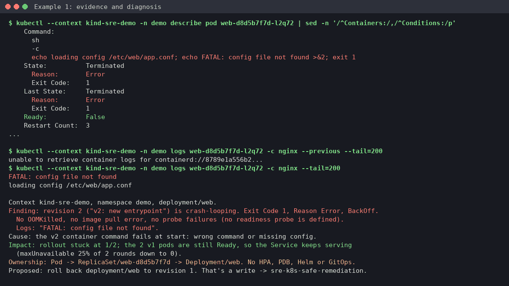
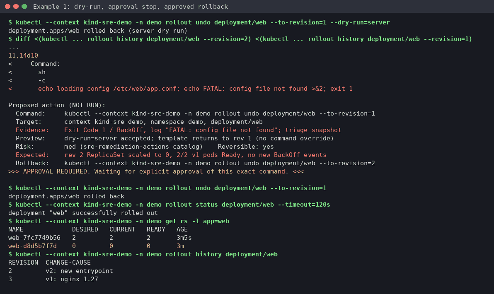

# Example 1: a crash-looping rollout on kind, triaged and rolled back

**Skills:** [sre-k8s-triage](../../.claude/skills/sre-k8s-triage/SKILL.md) for the diagnosis, then [sre-k8s-safe-remediation](../../.claude/skills/sre-k8s-safe-remediation/SKILL.md) for the rollback.

> **What's real here.** Command output comes from a lab run on 2026-10-22: kind v0.31.0 (node image v1.35.0), kubectl v1.31.14, Docker 26. Long output is trimmed where you see `...`, and pod IPs are replaced with `<pod-ip>`. The diagnosis and the proposal are **written in the skill's format** by the operator. They show the shape of the answer you should get, not a word-for-word model reply.



## What this shows

- The triage order the skill follows: context, pods, events, describe, logs, nodes, rollout, then ownership.
- Why the previous container's logs can come back empty, and what to read instead.
- The approval stop: a dry run, a revision diff and a proposal, then nothing runs until you say so.
- How the rollback is checked afterwards.

## Lab setup (about 3 minutes, no cloud)

You need Docker, [kind](https://kind.sigs.k8s.io/) and kubectl. The image is pulled on the host and loaded into the node, so the cluster doesn't need to reach a registry. `kubectl create deployment` already sets `imagePullPolicy: IfNotPresent` for a tagged image, so the node uses the loaded copy.

> **Kubeconfig.** `kind create cluster` adds a context to your kubeconfig and makes it the **current** context, so a later `kubectl` without `--context` would hit the lab, and one with your usual habits could hit something real. Keep the lab in its own file: run `export KUBECONFIG=$(mktemp)` in this shell first, and close the shell (or `unset KUBECONFIG`) when you're done. Every command below also names `--context kind-sre-demo`.

```console
$ export KUBECONFIG=$(mktemp)
$ kind create cluster --name sre-demo --wait 120s
$ docker pull nginx:1.27 && kind load docker-image nginx:1.27 --name sre-demo
$ kubectl --context kind-sre-demo create namespace demo
$ kubectl --context kind-sre-demo -n demo create deployment web --image=nginx:1.27 --replicas=2 --port=80
$ kubectl --context kind-sre-demo -n demo annotate deployment web kubernetes.io/change-cause='v1: nginx 1.27' --overwrite
$ kubectl --context kind-sre-demo -n demo expose deployment web --port=80
$ kubectl --context kind-sre-demo -n demo rollout status deployment/web --timeout=120s
```

## What broke

Revision 2 swaps the entrypoint for one that needs a config file the pod doesn't have:

```console
$ kubectl --context kind-sre-demo -n demo patch deployment web --type=json -p='[{"op":"add","path":"/spec/template/spec/containers/0/command","value":["sh","-c","echo loading config /etc/web/app.conf; echo FATAL: config file not found >&2; exit 1"]}]'
deployment.apps/web patched
$ kubectl --context kind-sre-demo -n demo annotate deployment web kubernetes.io/change-cause='v2: new entrypoint' --overwrite
$ kubectl --context kind-sre-demo -n demo get pods
NAME                   READY   STATUS    RESTARTS      AGE
web-7fc7749b56-htdbd   1/1     Running   0             51s
web-7fc7749b56-nsff7   1/1     Running   0             51s
web-d8d5b7f7d-l2q72    0/1     Error     3 (29s ago)   46s
```

## What you'd type

> A pod in namespace demo on kind-sre-demo keeps restarting since the last deploy. What's wrong?

## What the skill ran, and why

**1. Pin the target, then look at pods and Warning events.** These come first because they tell you which pod and which kind of failure you have.

```console
$ kubectl config get-contexts kind-sre-demo
CURRENT   NAME            CLUSTER         AUTHINFO        NAMESPACE
*         kind-sre-demo   kind-sre-demo   kind-sre-demo
$ kubectl --context kind-sre-demo -n demo events --types=Warning | tail -n 50
LAST SEEN           TYPE      REASON    OBJECT                    MESSAGE
25s (x3 over 66s)   Warning   BackOff   Pod/web-d8d5b7f7d-l2q72   Back-off restarting failed container nginx in pod ...
```

**2. Describe the pod** to get the exit code and reason. `Exit Code 1` with `Reason: Error` rules out OOMKilled (137) and image pull problems.

```console
$ kubectl --context kind-sre-demo -n demo describe pod web-d8d5b7f7d-l2q72 | sed -n '/^Containers:/,/^Conditions:/p'
    Command:
      sh
      -c
      echo loading config /etc/web/app.conf; echo FATAL: config file not found >&2; exit 1
    State:          Terminated
      Reason:       Error
      Exit Code:    1
    Last State:     Terminated
      Reason:       Error
      Exit Code:    1
    Ready:          False
    Restart Count:  3
...
```

**3. Read the logs.** The decision tree says `logs --previous` for a crash loop. Here the previous container had already been cleaned up, so it returned nothing useful. The skill then reads the current (just-exited) container, which works:

```console
$ kubectl --context kind-sre-demo -n demo logs web-d8d5b7f7d-l2q72 -c nginx --previous --tail=200
unable to retrieve container logs for containerd://8789e1a556b2...
$ kubectl --context kind-sre-demo -n demo logs web-d8d5b7f7d-l2q72 -c nginx --tail=200
FATAL: config file not found
loading config /etc/web/app.conf
```

**4. Rule out the node and the rollout settings.** The node is Ready with no pressure, the rollout is stuck at 1 of 2, and the deployment has no readiness probe.

```console
$ kubectl --context kind-sre-demo -n demo rollout history deployment/web
REVISION  CHANGE-CAUSE
1         v1: nginx 1.27
2         v2: new entrypoint
$ kubectl --context kind-sre-demo -n demo get deployment/web -o jsonpath='desired={.spec.replicas} ready={.status.readyReplicas} updated={.status.updatedReplicas}{"\n"}'
desired=2 ready=2 updated=1
```

**5. Check access, then save evidence.** On kind you're cluster admin, so the preflight fails on purpose: it warns you that this identity could read Secrets and write. On a real cluster, use a read-only identity (see [example 4](04-k8s-failure-modes.md)). The scripts live in the triage skill, so run them from there:

```console
$ cd "$(git rev-parse --show-toplevel)/.claude/skills/sre-k8s-triage"
$ bash scripts/k8s-preflight.sh --context kind-sre-demo -n demo
OK    can-i get pods                     => yes (want yes)
FAIL  can-i get secrets                  => yes (want no)
FAIL  can-i patch deployments            => yes (want no)
...
[exit 1]
$ bash scripts/k8s-triage-snapshot.sh --context kind-sre-demo -n demo
done: /tmp/k8s-triage/kind-sre-demo_demo_<timestamp> (1 unhealthy pods captured, max 20)
```

## The diagnosis (written in the skill's format)

```text
Context kind-sre-demo, namespace demo, deployment/web.
Finding: revision 2 ("v2: new entrypoint") is crash-looping. Exit Code 1, Reason Error, BackOff.
  No OOMKilled, no image pull error, no probe failures (no readiness probe is defined).
  Logs: "FATAL: config file not found".
Cause: the v2 container command fails at start: wrong command or missing config.
Impact: rollout stuck at 1/2; the 2 v1 pods are still Ready, so the Service keeps serving
  (maxUnavailable 25% of 2 rounds down to 0).
Ownership: Pod -> ReplicaSet/web-d8d5b7f7d -> Deployment/web. No HPA, PDB, Helm or GitOps.
Proposed: roll back deployment/web to revision 1. That's a write -> sre-k8s-safe-remediation.
```

## The approval stop



Before proposing anything, the remediation skill previews the change on the server and diffs the two revisions:

```console
$ kubectl --context kind-sre-demo -n demo rollout undo deployment/web --to-revision=1 --dry-run=server
deployment.apps/web rolled back (server dry run)
$ diff <(kubectl --context kind-sre-demo -n demo rollout history deployment/web --revision=2) <(kubectl --context kind-sre-demo -n demo rollout history deployment/web --revision=1)
1c1
< deployment.apps/web with revision #2
---
> deployment.apps/web with revision #1
4,5c4,5
< 	pod-template-hash=d8d5b7f7d
<   Annotations:	kubernetes.io/change-cause: v2: new entrypoint
---
> 	pod-template-hash=7fc7749b56
>   Annotations:	kubernetes.io/change-cause: v1: nginx 1.27
11,14d10
<     Command:
<       sh
<       -c
<       echo loading config /etc/web/app.conf; echo FATAL: config file not found >&2; exit 1
```

Then it stops (written in the skill's format):

```text
Proposed action (NOT RUN):
  Command:     kubectl --context kind-sre-demo -n demo rollout undo deployment/web --to-revision=1
  Target:      context kind-sre-demo, namespace demo, deployment/web
  Evidence:    Exit Code 1 / BackOff, log "FATAL: config file not found"; triage snapshot
  Preview:     dry-run=server accepted; template returns to rev 1 (no command override)
  Risk:        med (sre-remediation-actions catalog)    Reversible: yes
  Expected:    rev 2 ReplicaSet scaled to 0, 2/2 v1 pods Ready, no new BackOff events
  Rollback:    kubectl --context kind-sre-demo -n demo rollout undo deployment/web --to-revision=2
>>> APPROVAL REQUIRED. Waiting for explicit approval of this exact command. <<<
```

## Approved action and verification

After you approve, it runs that one command and checks the result:

```console
$ kubectl --context kind-sre-demo -n demo rollout undo deployment/web --to-revision=1
deployment.apps/web rolled back
$ kubectl --context kind-sre-demo -n demo rollout status deployment/web --timeout=120s
deployment "web" successfully rolled out
$ kubectl --context kind-sre-demo -n demo get rs -l app=web
NAME             DESIRED   CURRENT   READY   AGE
web-7fc7749b56   2         2         2       3m5s
web-d8d5b7f7d    0         0         0       3m
$ kubectl --context kind-sre-demo -n demo rollout history deployment/web
REVISION  CHANGE-CAUSE
2         v2: new entrypoint
3         v1: nginx 1.27
```

Revision 1 comes back as revision 3. That's normal: a rollback creates a new revision.

## Cleanup

```console
$ kind delete cluster --name sre-demo
$ rm -rf /tmp/k8s-triage/kind-sre-demo_demo_*   # the snapshot holds raw logs
$ rm -f "$KUBECONFIG"; unset KUBECONFIG
```

## What to take from this

- The rollback is a stopgap. The real fix is to ship the entrypoint together with its config through Git.
- If `logs --previous` comes back empty, read the current container's logs or the snapshot. Don't stop there.
- The preflight failing as kind admin is expected. On a real cluster, a FAIL means your identity can do more than read.
- A timeline and postmortem for this same incident are in [example 9](09-incident-lifecycle.md).
