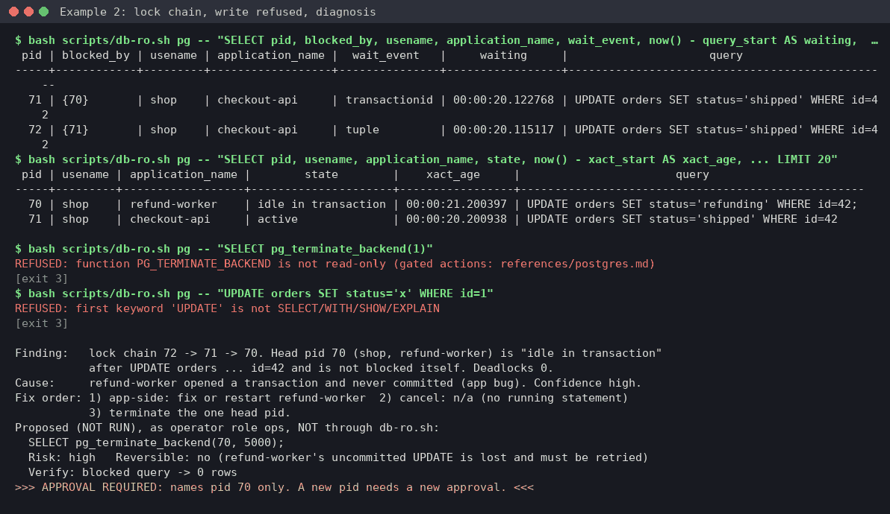
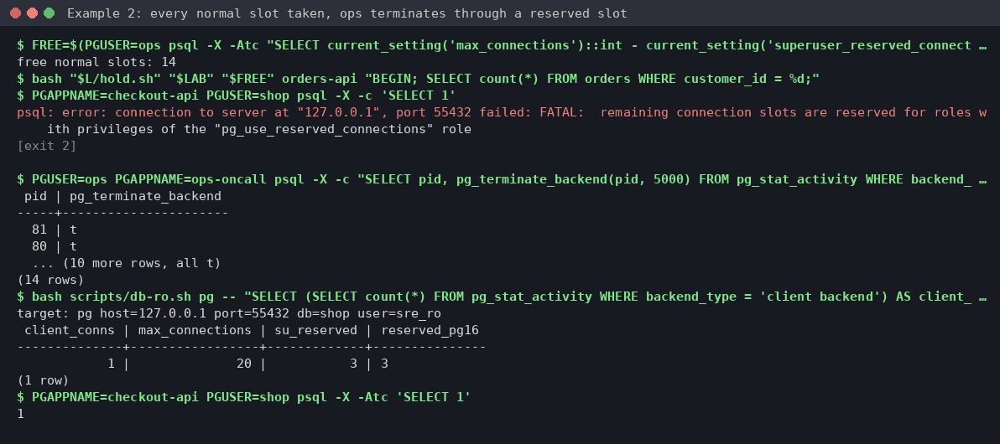

# Example 2: Postgres lock chain and connection exhaustion

**Skill:** [sre-database-triage](../../.claude/skills/sre-database-triage/SKILL.md), using [references/postgres.md](../../.claude/skills/sre-database-triage/references/postgres.md) and its scripts `db-ro.sh` (read-only wrapper) and `db-snapshot.sh` (evidence).

> **What's real here.** Every command and its output below comes from one run of this page, top to bottom, on 2026-10-22 with PostgreSQL 17.11 (`postgres:17` image) and psql 17.11. Pids and timings differ on each run; the temporary directory is shown as `/tmp/tmp.XXXXXXXXXX`. Diagnoses and proposals are **written in the skill's format** by the operator. They show the shape of the answer, not a word-for-word model reply.



## What this shows

- Finding the session at the head of a lock chain, rather than killing whichever query looks slow.
- `db-ro.sh` refusing writes, even when the role is already read-only.
- Two approval stops: one for a single pid, one for a filtered group of leaked sessions.
- Connection exhaustion done properly: the leak fills **every** normal slot, the app gets the real `FATAL`, and the triage and operator roles still get in through reserved slots.
- Two controls from this lab: without `pg_use_reserved_connections` the operator can't log in at all, and without `pg_read_all_stats` its terminate matches 0 rows.

## Lab setup (Docker, psql and python3)

The lab scripts are in [lab/postgres](lab/postgres/). `setup.sh` starts container `pg-lab` on 127.0.0.1:55432 with `max_connections=20`, then sets `reserved_connections = 3` with `ALTER SYSTEM` and restarts it, as the skill says to do in production (`superuser_reserved_connections` keeps its default of 3). It creates the roles from the reference ([roles.sql](lab/postgres/roles.sql): `sre_ro` read-only with `pg_monitor`; `ops` with `pg_signal_backend`, `pg_read_all_stats`; both with `pg_use_reserved_connections`), the `shop` tables and data ([seed.sql](lab/postgres/seed.sql)), generated passwords and a mode-600 pgpass, all in a directory you create with `mktemp -d`. Passwords are never echoed or put on a command line: the server only receives SCRAM verifiers ([scram.py](lab/postgres/scram.py)).

Run from anywhere inside your clone:

```console
$ REPO=$(git rev-parse --show-toplevel); L=$REPO/docs/examples/lab/postgres
$ LAB=$(mktemp -d)
$ bash "$L/setup.sh" "$LAB"
pg-lab ready on 127.0.0.1:55432 (lab files in /tmp/tmp.XXXXXXXXXX)
$ . "$LAB/env.sh"
$ cd "$REPO/.claude/skills/sre-database-triage"
```

`env.sh` sets `PGPASSFILE`, `PGHOST=127.0.0.1`, `PGPORT=55432`, `PGDATABASE=shop` and `PGUSER=sre_ro`. [hold.sh](lab/postgres/hold.sh) opens background sessions as `shop` that run one statement and then sit idle, the way a stuck app would.

## What broke (part 1): a forgotten transaction holds a row lock

An interactive shell also prints job numbers for the two background updates (`[1] 12345`) and `Done` lines after `wait`; they're left out below.

```console
$ bash "$L/hold.sh" "$LAB" 1 refund-worker "BEGIN; UPDATE orders SET status='refunding' WHERE id = 42;"
$ for i in 1 2; do PGAPPNAME=checkout-api PGUSER=shop psql -X -q -c "UPDATE orders SET status='shipped' WHERE id = 42" & done; sleep 3
```

## What you'd type

> Checkout updates on the shop database (127.0.0.1:55432) are hanging. Find out why.

## What the skill ran, and why

**1. Confirm the target and the role.** Every `db-ro.sh` call prints the target first, so a wrong host is obvious.

```console
$ bash scripts/db-ro.sh pg -- "SELECT version(), current_user, pg_is_in_recovery() AS is_replica LIMIT 1"
target: pg host=127.0.0.1 port=55432 db=shop user=sre_ro
                                                       version                                                        | current_user | is_replica
----------------------------------------------------------------------------------------------------------------------+--------------+------------
 PostgreSQL 17.11 (Debian 17.11-1.pgdg13+2) on x86_64-pc-linux-gnu, compiled by gcc (Debian 14.2.0-19) 14.2.0, 64-bit | sre_ro       | f
(1 row)
```

**2. Who is waiting, and on whom** (section 2 of the reference, run as written):

```console
$ bash scripts/db-ro.sh pg -- "SELECT pid, blocked_by, usename, application_name, wait_event, now() - query_start AS waiting, CASE WHEN query ILIKE '%password%' THEN '<redacted: contains password>' ELSE left(query, 200) END AS query FROM (SELECT a.*, pg_blocking_pids(a.pid) AS blocked_by FROM pg_stat_activity a WHERE a.wait_event_type = 'Lock') w ORDER BY query_start LIMIT 50"
target: pg host=127.0.0.1 port=55432 db=shop user=sre_ro
 pid | blocked_by | usename | application_name |  wait_event   |     waiting     |                      query
-----+------------+---------+------------------+---------------+-----------------+--------------------------------------------------
  49 | {47}       | shop    | checkout-api     | transactionid | 00:00:03.105    | UPDATE orders SET status='shipped' WHERE id = 42
  48 | {49}       | shop    | checkout-api     | tuple         | 00:00:03.104633 | UPDATE orders SET status='shipped' WHERE id = 42
(2 rows)
$ bash scripts/db-ro.sh pg -- "SELECT pid, usename, application_name, state, now() - xact_start AS xact_age, CASE WHEN query ILIKE '%password%' THEN '<redacted: contains password>' ELSE left(query, 200) END AS query FROM pg_stat_activity WHERE pid IN (SELECT unnest(pg_blocking_pids(pid)) FROM pg_stat_activity WHERE wait_event_type = 'Lock') LIMIT 20"
target: pg host=127.0.0.1 port=55432 db=shop user=sre_ro
 pid | usename | application_name |        state        |    xact_age     |                        query
-----+---------+------------------+---------------------+-----------------+-----------------------------------------------------
  47 | shop    | refund-worker    | idle in transaction | 00:00:05.165058 | UPDATE orders SET status='refunding' WHERE id = 42;
  49 | shop    | checkout-api     | active              | 00:00:03.167497 | UPDATE orders SET status='shipped' WHERE id = 42
(2 rows)
$ bash scripts/db-ro.sh pg -- "SELECT datname, deadlocks FROM pg_stat_database WHERE datname IS NOT NULL ORDER BY deadlocks DESC LIMIT 10"
target: pg host=127.0.0.1 port=55432 db=shop user=sre_ro
  datname  | deadlocks
-----------+-----------
 postgres  |         0
 shop      |         0
 template1 |         0
 template0 |         0
(4 rows)
```

**3. The wrapper won't run writes**, so the assistant can't "just fix it":

```console
$ bash scripts/db-ro.sh pg -- "SELECT pg_terminate_backend(1)"
REFUSED: function PG_TERMINATE_BACKEND is not read-only (gated actions: references/postgres.md)
[exit 3]
$ bash scripts/db-ro.sh pg -- "UPDATE orders SET status='x' WHERE id = 1"
REFUSED: first keyword 'UPDATE' is not SELECT/WITH/SHOW/EXPLAIN
[exit 3]
```

**4. Save evidence before any gated action** (into the lab directory, not your clone):

```console
$ bash scripts/db-snapshot.sh pg "$LAB/db-t0"
[skipped: top-statements failed, see /tmp/tmp.XXXXXXXXXX/db-t0/17-top-statements.txt]
snapshot: /tmp/tmp.XXXXXXXXXX/db-t0 (16 ok, 1 skipped)
```

The skipped file is expected: `pg_stat_statements` isn't installed in this lab.

## Diagnosis and approval stop (written in the skill's format)

```text
Finding:   lock chain 48 -> 49 -> 47. Head pid 47 (shop, refund-worker) is "idle in transaction"
           after UPDATE orders ... id = 42 and is not blocked itself. Deadlocks 0.
Cause:     refund-worker opened a transaction and never committed (app bug). Confidence high.
Fix order: 1) app-side: fix or restart refund-worker  2) cancel: n/a (no running statement)
           3) terminate the one head pid.
Proposed (NOT RUN), as operator role ops, NOT through db-ro.sh:
  SELECT pg_terminate_backend(47, 5000);
  Risk: high   Reversible: no (refund-worker's uncommitted UPDATE is lost and must be retried)
  Verify: blocked query -> 0 rows
>>> APPROVAL REQUIRED: names pid 47 only. A new pid needs a new approval. <<<
```

## Approved action and verification

The human runs it as `ops`. Use the head pid from your own step 2 (47 in this run). `wait` lets the two queued checkout updates finish:

```console
$ PGUSER=ops PGAPPNAME=ops-oncall psql -X -c 'SELECT pg_terminate_backend(47, 5000)'
 pg_terminate_backend
----------------------
 t
(1 row)
$ sleep 1; wait
$ bash scripts/db-ro.sh pg -- "SELECT pid, blocked_by, usename, application_name, wait_event, now() - query_start AS waiting, CASE WHEN query ILIKE '%password%' THEN '<redacted: contains password>' ELSE left(query, 200) END AS query FROM (SELECT a.*, pg_blocking_pids(a.pid) AS blocked_by FROM pg_stat_activity a WHERE a.wait_event_type = 'Lock') w ORDER BY query_start LIMIT 50"
target: pg host=127.0.0.1 port=55432 db=shop user=sre_ro
 pid | blocked_by | usename | application_name | wait_event | waiting | query
-----+------------+---------+------------------+------------+---------+-------
(0 rows)
$ PGUSER=shop psql -X -Atc "SELECT id, status FROM orders WHERE id = 42"
42|shipped
```

## What broke (part 2): a leaky pool holds every normal slot

Normal slots are `max_connections` − `superuser_reserved_connections` − `reserved_connections`, here 20 − 3 − 3 = 14. Count the free ones from the server instead of hard-coding them, then leak exactly that many sessions, and the next app connection fails:

```console
$ FREE=$(PGUSER=ops psql -X -Atc "SELECT current_setting('max_connections')::int - current_setting('superuser_reserved_connections')::int - current_setting('reserved_connections')::int - (SELECT count(*) FROM pg_stat_activity WHERE backend_type = 'client backend' AND pid <> pg_backend_pid())"); echo "free normal slots: $FREE"
free normal slots: 14
$ bash "$L/hold.sh" "$LAB" "$FREE" orders-api "BEGIN; SELECT count(*) FROM orders WHERE customer_id = %d;"
$ PGAPPNAME=checkout-api PGUSER=shop psql -X -c 'SELECT 1'
psql: error: connection to server at "127.0.0.1", port 55432 failed: FATAL:  remaining connection slots are reserved for roles with privileges of the "pg_use_reserved_connections" role
[exit 2]
```



The triage role still gets in through a reserved slot. Section 1 of the reference, run as written. The reference's idle threshold is 5 minutes, which would match none of these young sessions, so the preview uses 10 seconds (the reference says to lower it in that case):

```console
$ bash scripts/db-ro.sh pg -- "SELECT (SELECT count(*) FROM pg_stat_activity WHERE backend_type = 'client backend') AS client_conns, current_setting('max_connections')::int AS max_connections, current_setting('superuser_reserved_connections')::int AS su_reserved, current_setting('reserved_connections', true) AS reserved_pg16 LIMIT 1"
target: pg host=127.0.0.1 port=55432 db=shop user=sre_ro
 client_conns | max_connections | su_reserved | reserved_pg16
--------------+-----------------+-------------+---------------
           15 |              20 |           3 | 3
(1 row)
$ bash scripts/db-ro.sh pg -- "SELECT state, wait_event_type, usename, application_name, count(*) AS n FROM pg_stat_activity WHERE backend_type = 'client backend' GROUP BY 1, 2, 3, 4 ORDER BY n DESC LIMIT 50"
target: pg host=127.0.0.1 port=55432 db=shop user=sre_ro
        state        | wait_event_type | usename | application_name | n
---------------------+-----------------+---------+------------------+----
 idle in transaction | Client          | shop    | orders-api       | 14
 active              |                 | sre_ro  | sre-db-ro        |  1
(2 rows)
$ sleep 10
$ bash scripts/db-ro.sh pg -- "SELECT count(*) FROM pg_stat_activity WHERE backend_type = 'client backend' AND pid <> pg_backend_pid() AND usename = 'shop' AND application_name = 'orders-api' AND state = 'idle in transaction' AND now() - state_change > interval '10 seconds' LIMIT 1"
target: pg host=127.0.0.1 port=55432 db=shop user=sre_ro
 count
-------
    14
(1 row)
$ bash scripts/db-snapshot.sh pg "$LAB/db-t1"
[skipped: top-statements failed, see /tmp/tmp.XXXXXXXXXX/db-t1/17-top-statements.txt]
snapshot: /tmp/tmp.XXXXXXXXXX/db-t1 (16 ok, 1 skipped)
```

The proposal (written in the skill's format) names the app, the user and the previewed count, then stops with `>>> APPROVAL REQUIRED: names app orders-api, user shop, count 14. <<<`.

## Approved terminate, through a reserved slot

All 14 normal slots are still taken, and checkout still can't connect, but `ops` can, because it has `pg_use_reserved_connections`:

```console
$ PGUSER=ops PGAPPNAME=ops-oncall psql -X -c "SELECT pid, pg_terminate_backend(pid, 5000) FROM pg_stat_activity WHERE backend_type = 'client backend' AND pid <> pg_backend_pid() AND usename = 'shop' AND application_name = 'orders-api' AND state = 'idle in transaction' AND now() - state_change > interval '10 seconds'"
 pid | pg_terminate_backend
-----+----------------------
  81 | t
  80 | t
  82 | t
  83 | t
  88 | t
  84 | t
  87 | t
  85 | t
  86 | t
  89 | t
  76 | t
  77 | t
  78 | t
  79 | t
(14 rows)
$ bash scripts/db-ro.sh pg -- "SELECT (SELECT count(*) FROM pg_stat_activity WHERE backend_type = 'client backend') AS client_conns, current_setting('max_connections')::int AS max_connections, current_setting('superuser_reserved_connections')::int AS su_reserved, current_setting('reserved_connections', true) AS reserved_pg16 LIMIT 1"
target: pg host=127.0.0.1 port=55432 db=shop user=sre_ro
 client_conns | max_connections | su_reserved | reserved_pg16
--------------+-----------------+-------------+---------------
            1 |              20 |           3 | 3
(1 row)
$ PGAPPNAME=checkout-api PGUSER=shop psql -X -Atc 'SELECT 1'
1
```

## The controls: what each grant is for

The same leak, run again with one grant removed at a time (`docker exec` as `postgres`, inside the container):

```console
$ docker exec pg-lab psql -X -q -U postgres -c 'REVOKE pg_use_reserved_connections FROM ops'
$ bash "$L/hold.sh" "$LAB" "$FREE" orders-api "BEGIN; SELECT count(*) FROM orders WHERE customer_id = %d;"
$ PGUSER=ops psql -X -c 'SELECT 1'
psql: error: connection to server at "127.0.0.1", port 55432 failed: FATAL:  remaining connection slots are reserved for roles with privileges of the "pg_use_reserved_connections" role
[exit 2]
$ docker exec pg-lab psql -X -q -U postgres -c 'GRANT pg_use_reserved_connections TO ops' -c 'REVOKE pg_read_all_stats FROM ops'
$ sleep 10
$ PGUSER=ops PGAPPNAME=ops-oncall psql -X -c "SELECT pid, pg_terminate_backend(pid, 5000) FROM pg_stat_activity WHERE backend_type = 'client backend' AND pid <> pg_backend_pid() AND usename = 'shop' AND application_name = 'orders-api' AND state = 'idle in transaction' AND now() - state_change > interval '10 seconds'"
 pid | pg_terminate_backend
-----+----------------------
(0 rows)
$ docker exec pg-lab psql -X -q -U postgres -c 'GRANT pg_read_all_stats TO ops'
$ PGUSER=ops PGAPPNAME=ops-oncall psql -X -At -c "SELECT pid, pg_terminate_backend(pid, 5000) FROM pg_stat_activity WHERE backend_type = 'client backend' AND pid <> pg_backend_pid() AND usename = 'shop' AND application_name = 'orders-api' AND state = 'idle in transaction' AND now() - state_change > interval '10 seconds'" | wc -l
14
```

- Without `pg_use_reserved_connections`, `ops` gets the same `FATAL` as the app, so the approved terminate can't even start. The first version of this example missed that: the operator had no reserved slot, and the leak stopped one short of filling the normal slots. The skill now sets up the reserved slot for both roles (reference, "When every normal slot is taken").
- Without `pg_read_all_stats`, `ops` can log in but the filtered terminate matches **0 rows**: Postgres hides other users' `state` from it, so the filter never matches.

## Cleanup

`teardown.sh` stops the sessions from `hold.sh`, removes the container and deletes the lab directory with its passwords and snapshots:

```console
$ cd "$REPO"; bash "$L/teardown.sh" "$LAB"
pg-lab removed
$ ls -d "$LAB" 2>&1; docker ps -a --filter name=pg-lab --format "{{.Names}}"
ls: cannot access '/tmp/tmp.XXXXXXXXXX': No such file or directory
```

## What to take from this

- Terminate the head of the chain, not the waiters. Here, one pid freed two queued requests.
- Always preview a filtered terminate's count. Then check the count the terminate actually returns: "0 rows" means it did nothing.
- Set up `reserved_connections` (restart) and `pg_use_reserved_connections` for the triage **and** operator roles before an incident, and give the operator `pg_signal_backend` **and** `pg_read_all_stats`. On PostgreSQL 15 and earlier, see the reference for the options.
- Terminating sessions treats the symptom. The fix is in the app (commit or roll back, smaller pool, `idle_in_transaction_session_timeout`).
