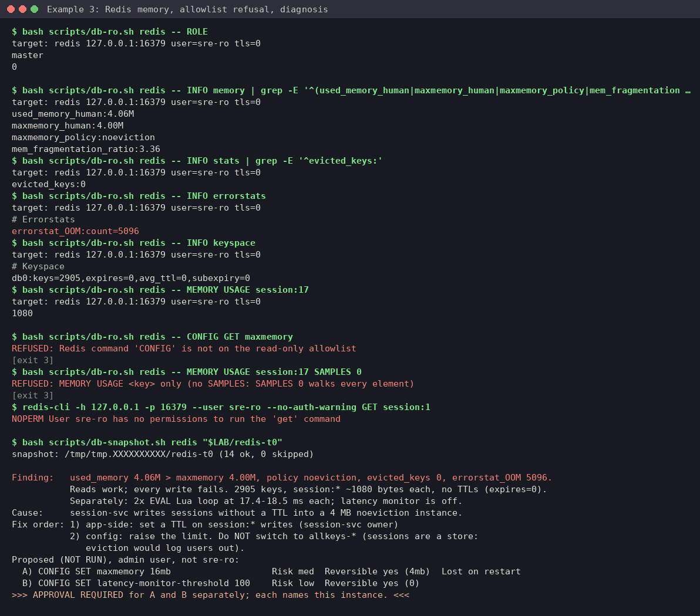
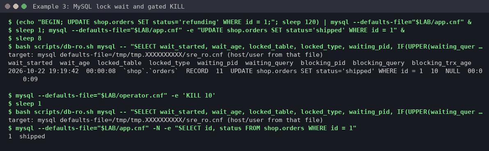

# Example 3: Redis out of memory, plus a MySQL lock wait

**Skill:** [sre-database-triage](../../.claude/skills/sre-database-triage/SKILL.md), using [references/redis.md](../../.claude/skills/sre-database-triage/references/redis.md) and [references/mysql.md](../../.claude/skills/sre-database-triage/references/mysql.md).

> **What's real here.** Every command and its output below comes from one run of this page, top to bottom, on 2026-10-22 with Redis 7.4.11 (`redis:7.4`, host redis-cli 8.0) and MySQL 8.4.13 (`mysql:8.4`, host MariaDB 11.8 client). The temporary directory is shown as `/tmp/tmp.XXXXXXXXXX` and client addresses as `<client-addr>`. Diagnoses and proposals are **written in the skill's format** by the operator. They show the shape of the answer, not a word-for-word model reply.



## What this shows

- Telling "the store is full" apart from "a command is slow", using only read-only commands.
- The Redis allowlist: `CONFIG`, `GET` and `MEMORY USAGE ... SAMPLES 0` are refused.
- Why the skill won't propose `allkeys-lru` when the data is sessions.
- A MySQL lock wait traced to an idle transaction, then a gated `KILL`.

## Lab setup (Docker, python3, redis-cli and a mysql client)

The lab scripts are in [lab/redis-mysql](lab/redis-mysql/). `setup.sh` generates every password into a directory you create with `mktemp -d` (mode 600, never echoed or put on a command line) and starts two containers:

- `redis-lab` on 127.0.0.1:56379, from a generated config file: `maxmemory 4mb`, `noeviction`, an admin password, and the read-only user `sre-ro` with exactly the ACL from redis.md "Access" ([redis-acl.txt](lab/redis-mysql/redis-acl.txt)).
- `mysql-lab` on 127.0.0.1:53306: `sre_ro` created as in mysql.md "Access" (`REQUIRE SSL`, `MAX_USER_CONNECTIONS 3`), an `operator` account with `CONNECTION_ADMIN` for the approved `KILL`, an `app` account and table `shop.orders` ([mysql.sql](lab/redis-mysql/mysql.sql)). Each account gets its own mode-600 option file.

`env.sh` points `db-ro.sh` at both (`REDIS_HOST`, `REDIS_PORT`, `REDIS_USER`, `REDISCLI_AUTH` read from the password file, `MYSQL_DEFAULTS_FILE`) and defines `radmin`, an admin `redis-cli` that reads the admin password from its file into `REDISCLI_AUTH`, so it never appears on a command line or in `ps`.

Run from anywhere inside your clone:

```console
$ REPO=$(git rev-parse --show-toplevel); L=$REPO/docs/examples/lab/redis-mysql
$ LAB=$(mktemp -d)
$ bash "$L/setup.sh" "$LAB"
redis-lab ready on 127.0.0.1:56379, mysql-lab ready on 127.0.0.1:53306 (lab files in /tmp/tmp.XXXXXXXXXX)
$ . "$LAB/env.sh"
$ cd "$REPO/.claude/skills/sre-database-triage"
```

## What broke

A session service writes ~1 KB values with no TTL until the 4 MB limit, then a CPU-heavy Lua script runs twice. `redis-cli` prints an empty line after each error, hence the blank count:

```console
$ python3 -c 'for i in range(1, 8001): print(f"SET session:{i} " + "x" * 1000)' > "$LAB/load.txt"
$ radmin < "$LAB/load.txt" | sort | uniq -c | sort -rn
   5095 OOM command not allowed when used memory > 'maxmemory'.
   5095
   2905 OK
$ radmin SET cart:1 checkout-in-progress
OOM command not allowed when used memory > 'maxmemory'.

$ for i in 1 2; do radmin EVAL "local s=0 for i=1,3000000 do s=s+i end return s" 0; done
4500001500000
4500001500000
```

## What you'd type

> Redis at 127.0.0.1:56379 is rejecting writes with OOM errors and checkout is failing. Triage it.

## What the skill ran, and why

**1. Role and memory.** It checks this is the primary, then compares used memory with the limit and policy:

```console
$ bash scripts/db-ro.sh redis -- ROLE
target: redis 127.0.0.1:56379 user=sre-ro tls=0
master
0

$ bash scripts/db-ro.sh redis -- INFO memory | grep -E '^(used_memory_human|maxmemory_human|maxmemory_policy|mem_fragmentation_ratio):'
target: redis 127.0.0.1:56379 user=sre-ro tls=0
used_memory_human:4.06M
maxmemory_human:4.00M
maxmemory_policy:noeviction
mem_fragmentation_ratio:3.36
$ bash scripts/db-ro.sh redis -- INFO stats | grep -E '^evicted_keys:'
target: redis 127.0.0.1:56379 user=sre-ro tls=0
evicted_keys:0
$ bash scripts/db-ro.sh redis -- INFO errorstats
target: redis 127.0.0.1:56379 user=sre-ro tls=0
# Errorstats
errorstat_OOM:count=5096
$ bash scripts/db-ro.sh redis -- INFO keyspace
target: redis 127.0.0.1:56379 user=sre-ro tls=0
# Keyspace
db0:keys=2905,expires=0,avg_ttl=0,subexpiry=0
$ bash scripts/db-ro.sh redis -- MEMORY USAGE session:17
target: redis 127.0.0.1:56379 user=sre-ro tls=0
1080
$ bash scripts/db-ro.sh redis -- MEMORY DOCTOR
target: redis 127.0.0.1:56379 user=sre-ro tls=0
Hi Sam, this instance is empty or is using very little memory, my issues detector can't be used in these conditions. Please, leave for your mission on Earth and fill it with some data. The new Sam and I will be back to our programming as soon as I finished rebooting.
```

`MEMORY DOCTOR` gives no signal here: it declines to analyse instances under 5 MB, so the reference says to read `INFO memory` and `errorstats` instead.

**2. Slow commands, a separate problem:**

```console
$ bash scripts/db-ro.sh redis -- SLOWLOG GET 25
target: redis 127.0.0.1:56379 user=sre-ro tls=0
1
1792696779
17430
EVAL
local s=0 for i=1,3000000 do s=s+i end return s
0
<client-addr>

0
1792696779
18539
EVAL
local s=0 for i=1,3000000 do s=s+i end return s
0
<client-addr>

$ bash scripts/db-ro.sh redis -- LATENCY DOCTOR
target: redis 127.0.0.1:56379 user=sre-ro tls=0
I'm sorry, Dave, I can't do that. Latency monitoring is disabled in this Redis instance. You may use "CONFIG SET latency-monitor-threshold <milliseconds>." in order to enable it. If we weren't in a deep space mission I'd suggest to take a look at https://redis.io/topics/latency-monitor.
```

**3. The guards hold**, then evidence goes into the lab directory:

```console
$ bash scripts/db-ro.sh redis -- CONFIG GET maxmemory
REFUSED: Redis command 'CONFIG' is not on the read-only allowlist
[exit 3]
$ bash scripts/db-ro.sh redis -- MEMORY USAGE session:17 SAMPLES 0
REFUSED: MEMORY USAGE <key> only (no SAMPLES: SAMPLES 0 walks every element)
[exit 3]
$ redis-cli -h 127.0.0.1 -p 56379 --user sre-ro --no-auth-warning GET session:1
NOPERM User sre-ro has no permissions to run the 'get' command

$ bash scripts/db-snapshot.sh redis "$LAB/redis-t0"
snapshot: /tmp/tmp.XXXXXXXXXX/redis-t0 (14 ok, 0 skipped)
```

## Diagnosis and approval stop (written in the skill's format)

```text
Finding:   used_memory 4.06M > maxmemory 4.00M, policy noeviction, evicted_keys 0, errorstat_OOM 5096.
           Reads work; every write fails. 2905 keys, session:* ~1080 bytes each, no TTLs (expires=0).
           Separately: 2x EVAL Lua loop at 17.4-18.5 ms each; latency monitor is off.
Cause:     session-svc writes sessions without a TTL into a 4 MB noeviction instance.
Fix order: 1) app-side: set a TTL on session:* writes (session-svc owner)
           2) config: raise the limit. Do NOT switch to allkeys-* (sessions are a store:
              eviction would log users out).
Proposed (NOT RUN), admin user, not sre-ro:
  A) CONFIG SET maxmemory 16mb                   Risk med  Reversible yes (4mb)  Lost on restart
  B) CONFIG SET latency-monitor-threshold 100    Risk low  Reversible yes (0)
>>> APPROVAL REQUIRED for A and B separately; each names this instance. <<<
```

## Approved action and verification

The human runs both as the admin (`radmin`). To check the latency monitor, one heavier script (30 million iterations) runs afterwards:

```console
$ radmin CONFIG SET maxmemory 16mb
OK
$ radmin CONFIG SET latency-monitor-threshold 100
OK
$ radmin SET cart:1 checkout-in-progress
OK
$ bash scripts/db-ro.sh redis -- INFO memory | grep -E '^(used_memory_human|maxmemory_human):'
target: redis 127.0.0.1:56379 user=sre-ro tls=0
used_memory_human:4.28M
maxmemory_human:16.00M
$ radmin EVAL "local s=0 for i=1,30000000 do s=s+i end return s" 0
450000015000000
$ bash scripts/db-ro.sh redis -- LATENCY LATEST
target: redis 127.0.0.1:56379 user=sre-ro tls=0
command
1792696781
166
166
```

## Bonus: MySQL lock wait



An idle transaction holds row 1, and a second update waits. The lock-wait query is the one from mysql.md section 2, run as written:

```console
$ (echo "BEGIN; UPDATE shop.orders SET status='refunding' WHERE id = 1;"; sleep 120) | mysql --defaults-file="$LAB/app.cnf" &
$ sleep 1; mysql --defaults-file="$LAB/app.cnf" -e "UPDATE shop.orders SET status='shipped' WHERE id = 1" &
$ sleep 8
$ bash scripts/db-ro.sh mysql -- "SELECT wait_started, wait_age, locked_table, locked_type, waiting_pid, IF(UPPER(waiting_query) LIKE '%PASSWORD%' OR UPPER(waiting_query) LIKE '%IDENTIFIED%', '<redacted: contains password>', LEFT(waiting_query, 200)) AS waiting_query, blocking_pid, IF(UPPER(blocking_query) LIKE '%PASSWORD%' OR UPPER(blocking_query) LIKE '%IDENTIFIED%', '<redacted: contains password>', LEFT(blocking_query, 200)) AS blocking_query, blocking_trx_age FROM sys.x\$innodb_lock_waits ORDER BY wait_started LIMIT 20"
target: mysql defaults-file=/tmp/tmp.XXXXXXXXXX/sre_ro.cnf (host/user from that file)
wait_started	wait_age	locked_table	locked_type	waiting_pid	waiting_query	blocking_pid	blocking_query	blocking_trx_age
2026-10-22 19:19:42	00:00:08	`shop`.`orders`	RECORD	11	UPDATE shop.orders SET status='shipped' WHERE id = 1	10	NULL	00:00:09
```

`blocking_query NULL` with an open transaction means the blocker is idle, not busy. The proposal (written in the skill's format) was `KILL 10;` as the operator account, risk high, not reversible (its transaction rolls back), `>>> APPROVAL REQUIRED: names thread 10 only. <<<`. After approval (use the `blocking_pid` from your own run):

```console
$ mysql --defaults-file="$LAB/operator.cnf" -e 'KILL 10'
$ sleep 1
$ bash scripts/db-ro.sh mysql -- "SELECT wait_started, wait_age, locked_table, locked_type, waiting_pid, IF(UPPER(waiting_query) LIKE '%PASSWORD%' OR UPPER(waiting_query) LIKE '%IDENTIFIED%', '<redacted: contains password>', LEFT(waiting_query, 200)) AS waiting_query, blocking_pid, IF(UPPER(blocking_query) LIKE '%PASSWORD%' OR UPPER(blocking_query) LIKE '%IDENTIFIED%', '<redacted: contains password>', LEFT(blocking_query, 200)) AS blocking_query, blocking_trx_age FROM sys.x\$innodb_lock_waits ORDER BY wait_started LIMIT 20"
target: mysql defaults-file=/tmp/tmp.XXXXXXXXXX/sre_ro.cnf (host/user from that file)
$ mysql --defaults-file="$LAB/app.cnf" -N -e "SELECT id, status FROM shop.orders WHERE id = 1"
1	shipped
```

The lock-wait query now returns no rows (`db-ro.sh` prints nothing for an empty MySQL result): nothing is waiting any more.

## Cleanup

`teardown.sh` removes both containers and deletes the lab directory with its passwords, option files and snapshot:

```console
$ kill $(jobs -p) 2>/dev/null; cd "$REPO"; bash "$L/teardown.sh" "$LAB"
redis-lab and mysql-lab removed
```

## What to take from this

- `noeviction` plus no TTLs is a store that fills up. Raising the limit buys time. The fix is a TTL in the app.
- Pick eviction policy by what the data is. For sessions, evicting means logging users out.
- Check the latency monitor is on before an incident. `LATENCY DOCTOR` has nothing to say until it is.
- For MySQL, `sys.x$innodb_lock_waits` names the blocker. A `NULL` blocking query means an idle transaction: fix the app that left it open.
