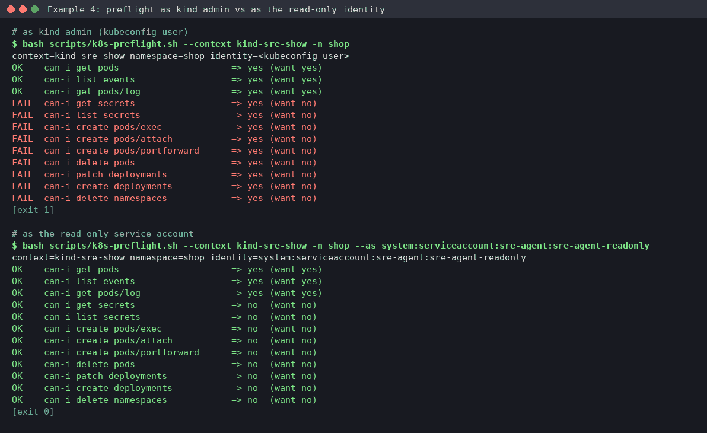
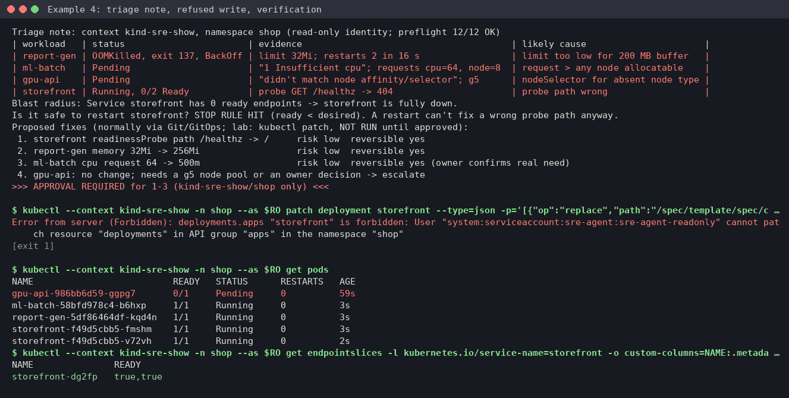

# Example 4: four Kubernetes failure modes, triaged as a read-only identity

**Skill:** [sre-k8s-triage](../../.claude/skills/sre-k8s-triage/SKILL.md), with its read-only RBAC ([references/rbac-readonly.yaml](../../.claude/skills/sre-k8s-triage/references/rbac-readonly.yaml)) and preflight.

> **What's real here.** Command output comes from a lab run on 2026-10-22: kind v0.31.0 (node image v1.35.0), kubectl v1.31.14. Long output is trimmed where you see `...`, and pod IPs are replaced with `<pod-ip>`. The triage note and proposals are **written in the skill's format** by the operator. They show the shape of the answer, not a word-for-word model reply.



## What this shows

- Setting up the pack's read-only role, and the preflight proving the agent identity can't read Secrets or write.
- One triage pass that sorts four different failures: OOMKilled, Pending (CPU), Pending (node selector) and a failing readiness probe.
- The "is it safe to restart?" stop rule, and why a restart wouldn't help here anyway.
- The read-only identity being refused a write, even after approval.

## Lab setup (kind, no cloud)

The workloads are in [lab/k8s-failure-modes.yaml](lab/k8s-failure-modes.yaml). Run from the skill folder (`.claude/skills/sre-k8s-triage`):

```console
$ kind create cluster --name sre-show --wait 120s
$ docker pull nginx:1.27 && docker pull busybox:1.36 && kind load docker-image nginx:1.27 busybox:1.36 --name sre-show
$ kubectl --context kind-sre-show create namespace shop
$ kubectl --context kind-sre-show apply -f ../../../docs/examples/lab/k8s-failure-modes.yaml
$ kubectl --context kind-sre-show create namespace sre-agent
$ sed 's/<target-namespace>/shop/' references/rbac-readonly.yaml | kubectl --context kind-sre-show apply -f -
serviceaccount/sre-agent-readonly created
clusterrole.rbac.authorization.k8s.io/sre-agent-readonly created
...
```

## What broke

| Workload | Planted fault |
|---|---|
| report-gen | 32Mi memory limit, but the process buffers 200 MB |
| ml-batch | requests 64 CPUs on an 8-CPU node |
| gpu-api | `nodeSelector` for `g5.xlarge`, which doesn't exist here |
| storefront | readiness probe on `/healthz`, which nginx answers with 404 |

## What you'd type

> Several workloads in namespace shop on kind-sre-show are unhealthy. Triage them as the read-only service account sre-agent:sre-agent-readonly.

## What the skill ran, and why

**1. Preflight: is this identity really read-only?** As kind admin, 9 checks FAIL (exit 1). As the service account, all 12 pass:

```console
$ bash scripts/k8s-preflight.sh --context kind-sre-show -n shop --as system:serviceaccount:sre-agent:sre-agent-readonly
context=kind-sre-show namespace=shop identity=system:serviceaccount:sre-agent:sre-agent-readonly
OK    can-i get pods                     => yes (want yes)
OK    can-i get pods/log                 => yes (want yes)
OK    can-i get secrets                  => no  (want no)
OK    can-i create pods/exec             => no  (want no)
OK    can-i patch deployments            => no  (want no)
...
[exit 0]
```

Every command below adds `--as system:serviceaccount:sre-agent:sre-agent-readonly`, shortened here to `--as $RO`.

**2. Pods and Warning events.** One pass shows all four faults:

```console
$ kubectl --context kind-sre-show -n shop --as $RO get pods
NAME                          READY   STATUS      RESTARTS      AGE
gpu-api-986bb6d59-ggpg7       0/1     Pending     0             17s
ml-batch-54c6c8d7c5-ggpvd     0/1     Pending     0             17s
report-gen-57c89458c-j58ft    0/1     OOMKilled   2 (16s ago)   17s
storefront-6bd7949549-lvr2q   0/1     Running     0             17s
storefront-6bd7949549-x655h   0/1     Running     0             17s
$ kubectl --context kind-sre-show -n shop --as $RO events --types=Warning | tail -n 50
(LAST SEEN and TYPE columns trimmed)
REASON             OBJECT                            MESSAGE
FailedScheduling   Pod/gpu-api-986bb6d59-ggpg7       0/1 nodes are available: 1 node(s) didn't match Pod's node affinity/selector. ...
FailedScheduling   Pod/ml-batch-54c6c8d7c5-ggpvd     0/1 nodes are available: 1 Insufficient cpu. ...
BackOff            Pod/report-gen-57c89458c-j58ft    Back-off restarting failed container worker in pod ...
Unhealthy          Pod/storefront-6bd7949549-lvr2q   Readiness probe failed: HTTP probe failed with statuscode: 404
```

**3. Follow each branch of the decision tree.**

```console
$ kubectl --context kind-sre-show -n shop --as $RO describe pod report-gen-57c89458c-j58ft | grep -A6 -E 'Last State|Limits'
    Last State:     Terminated
      Reason:       OOMKilled
      Exit Code:    137
    Limits:
      memory:  32Mi
$ kubectl --context kind-sre-show --as $RO get nodes -o custom-columns=NAME:.metadata.name,CPU:.status.allocatable.cpu,TYPE:.metadata.labels.node\.kubernetes\.io/instance-type
NAME                     CPU   TYPE
sre-show-control-plane   8     <none>
$ kubectl --context kind-sre-show -n shop --as $RO logs storefront-6bd7949549-lvr2q --tail=200 | grep -m2 healthz
... open() "/usr/share/nginx/html/healthz" failed (2: No such file or directory), client: <pod-ip>, ...
<pod-ip> - - [22/Oct/2026:18:12:07 +0000] "GET /healthz HTTP/1.1" 404 153 "-" "kube-probe/1.35" "-"
$ kubectl --context kind-sre-show -n shop --as $RO get endpointslices -l kubernetes.io/service-name=storefront -o custom-columns=NAME:.metadata.name,READY:.endpoints[*].conditions.ready
NAME               READY
storefront-dg2fp   false,false
```

`logs --previous` for report-gen returned "unable to retrieve container logs": the container restarts every few seconds. `top` failed with "Metrics API not available" (kind has no metrics-server). The skill says both can happen and moves on.

**4. Is it safe to restart storefront?** It runs the read-only checklist: `desired=2 ready=` (none), no PDB, no HPA, RollingUpdate 25%/25%. Then `k8s-triage-snapshot.sh -o ./incident/k8s-shop` saves the evidence (5 unhealthy pods captured).

## The diagnosis and approval stop (written in the skill's format)



```text
Triage note: context kind-sre-show, namespace shop (read-only identity; preflight 12/12 OK)
| workload   | status                       | evidence                                       | likely cause                      |
| report-gen | OOMKilled, exit 137, BackOff | limit 32Mi; restarts 2 in 16 s                 | limit too low for 200 MB buffer   |
| ml-batch   | Pending                      | "1 Insufficient cpu"; requests cpu=64, node=8  | request > any node allocatable    |
| gpu-api    | Pending                      | "didn't match node affinity/selector"; g5      | nodeSelector for absent node type |
| storefront | Running, 0/2 Ready           | probe GET /healthz -> 404                      | probe path wrong                  |
Blast radius: Service storefront has 0 ready endpoints -> storefront is fully down.
Is it safe to restart storefront? STOP RULE HIT (ready < desired). A restart can't fix a wrong probe path anyway.
Proposed fixes (normally via Git/GitOps; lab: kubectl patch, NOT RUN until approved):
 1. storefront readinessProbe path /healthz -> /     risk low  reversible yes
 2. report-gen memory 32Mi -> 256Mi                  risk low  reversible yes
 3. ml-batch cpu request 64 -> 500m                  risk low  reversible yes (owner confirms real need)
 4. gpu-api: no change; needs a g5 node pool or an owner decision -> escalate
>>> APPROVAL REQUIRED for 1-3 (kind-sre-show/shop only) <<<
```

## Approved action and verification

Even with approval, the read-only identity can't write. That's the point of it:

```console
$ kubectl --context kind-sre-show -n shop --as $RO patch deployment storefront --type=json -p='[{"op":"replace","path":"/spec/template/spec/containers/0/readinessProbe/httpGet/path","value":"/"}]'
Error from server (Forbidden): deployments.apps "storefront" is forbidden: User "system:serviceaccount:sre-agent:sre-agent-readonly" cannot patch resource "deployments" in API group "apps" in the namespace "shop"
[exit 1]
```

A human with write access ran the three approved patches (the same patch as above without `--as`, plus `resources/limits/memory` and `requests/memory` to 256Mi, and `requests/cpu` to 500m):

```console
$ kubectl --context kind-sre-show -n shop --as $RO get pods
NAME                          READY   STATUS      RESTARTS   AGE
gpu-api-986bb6d59-ggpg7       0/1     Pending     0          59s
ml-batch-58bfd978c4-b6hxp     1/1     Running     0          3s
report-gen-5df86464df-kqd4n   1/1     Running     0          3s
storefront-f49d5cbb5-fmshm    1/1     Running     0          3s
storefront-f49d5cbb5-v72vh    1/1     Running     0          2s
$ kubectl --context kind-sre-show -n shop --as $RO get endpointslices -l kubernetes.io/service-name=storefront -o custom-columns=NAME:.metadata.name,READY:.endpoints[*].conditions.ready
NAME               READY
storefront-dg2fp   true,true
```

gpu-api stays Pending on purpose: it was escalated, not "fixed".

## Cleanup

```console
$ kind delete cluster --name sre-show
$ rm -rf ./incident/k8s-shop
```

## What to take from this

- Run the agent as a read-only identity and prove it with the preflight. If the agent goes wrong, the API server refuses it.
- Events plus `describe` sort most failures in one pass. Each status has its own branch in the decision tree.
- "Restart it" is often wrong. The stop rule caught it here, and a restart wouldn't have fixed a probe path anyway.
- Some fixes aren't yours to make. A missing node pool is an owner decision, so escalate it.
