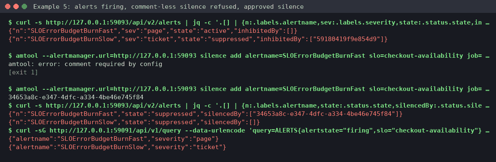

# Example 5: SLO burn-rate rules, from generator to a gated silence

**Skills:** [sre-slo-burn-rate-rules](../../.claude/skills/sre-slo-burn-rate-rules/SKILL.md) to generate and test the rules, [sre-prometheus-grafana](../../.claude/skills/sre-prometheus-grafana/SKILL.md) to read the live alert and propose the silence, and [sre-slo-alerting](../../.claude/skills/sre-slo-alerting/SKILL.md) for the responder query.

> **What's real here.** Command output comes from a lab run on 2026-10-22 with Prometheus v3.15.0, Alertmanager v0.34.1 (amtool from the same image) and promtool 3.15.0. Long output is trimmed where you see `...`. The proposal is **written in the skill's format** by the operator. It shows the shape of the answer, not a word-for-word model reply.



## What this shows

- Generating multiwindow burn-rate rules for a 99.9% SLO, then linting and unit-testing them before they go live.
- A real fast burn (5% errors = 50x budget) firing both the page and ticket alerts, with inhibition muting the ticket.
- A silence as a gated change: equality matchers only, a preview of what it hits, and an author, comment and expiry.
- Silences act in Alertmanager only. Prometheus keeps evaluating the alert as firing.

## Lab setup (Docker, loopback only)

The lab files are in [lab/slo-burn-rate/](lab/slo-burn-rate/). [exporter.py](lab/slo-burn-rate/exporter.py) is a fake checkout service that serves `http_requests_total` at about 100 req/s, 5% of them HTTP 500. Alertmanager has a null receiver, so nothing is sent. From the repo root:

```console
$ cd docs/examples/lab/slo-burn-rate
$ python3 ../../../../.claude/skills/sre-prometheus-grafana/scripts/gen-burn-rate-rules.py --slo-name checkout-availability --objective 0.999 \
    --errors 'http_requests_total{job="checkout",code=~"5.."}' --total 'http_requests_total{job="checkout"}' \
    --by job --runbook-url 'https://runbooks.example.com/slo/checkout-availability' --out slo-checkout.rules.yml
$ python3 exporter.py &
$ docker run -d --name lab-am --network host -v "$PWD/alertmanager.yml:/etc/alertmanager/alertmanager.yml:ro" prom/alertmanager:v0.34.1 \
    --config.file=/etc/alertmanager/alertmanager.yml --web.listen-address=127.0.0.1:59093 --cluster.listen-address=
$ docker run -d --name lab-prom --network host -v "$PWD/prometheus.yml:/etc/prometheus/prometheus.yml:ro" \
    -v "$PWD/slo-checkout.rules.yml:/etc/prometheus/slo-checkout.rules.yml:ro" prom/prometheus:v3.15.0 \
    --config.file=/etc/prometheus/prometheus.yml --web.listen-address=127.0.0.1:59091
```

Both alerts fire within about a minute. The generated rules have no `for:`; the multiwindow condition does the filtering.

## What broke

Checkout returns errors on 5% of requests. With a 99.9% objective, the error budget is 0.1%, so the budget burns 50 times faster than sustainable.

## What you'd type

> Write burn-rate alerts for checkout-availability at 99.9%, test them, and then tell me what's firing on the lab Prometheus at 127.0.0.1:59091.

## What the skill ran, and why

**1. Generate, lint and unit-test before anything goes live.** The tier table is the standard one: page at 14.4x (1h and 5m) and 6x (6h and 30m), ticket at 3x (1d and 2h) and 1x (3d and 6h).

```console
$ grep -nE 'alert:|severity' slo-checkout.rules.yml
57:      - alert: SLOErrorBudgetBurnFast
71:          severity: page
77:      - alert: SLOErrorBudgetBurnSlow
91:          severity: ticket
$ promtool check rules --lint=all --lint-fatal slo-checkout.rules.yml
Checking slo-checkout.rules.yml
  SUCCESS: 9 rules found
$ promtool test rules slo-checkout.test.yml     # the pack's references/slo-burn-rate.test.yml, names adapted
  SUCCESS
```

**2. Read-only checks on the live server:** is the target up, are the rules healthy, and what is the burn rate?

```console
$ curl -s http://127.0.0.1:59091/api/v1/targets | jq -c '.data.activeTargets[] | {job:.labels.job,health,lastError}'
{"job":"checkout","health":"up","lastError":""}
$ curl -s http://127.0.0.1:59091/api/v1/rules | jq -c '.data.groups[] | {name,rules:(.rules|length),health:([.rules[].health]|unique)}'
{"name":"slo-checkout-availability","rules":9,"health":["ok"]}
$ promtool query instant http://127.0.0.1:59091 'slo:sli_error:ratio_rate5m{slo="checkout-availability"} / 0.001'
{job="checkout", slo="checkout-availability"} => 50 @[1792692935.819]
```

The divisor `0.001` is `1 - 0.999`, the error budget. A burn rate of 50 spends 30 days of budget in under 15 hours.

**3. What Alertmanager does with it.** The page is active. The ticket is suppressed by the inhibit rule (page beats ticket for the same SLO):

```console
$ curl -s http://127.0.0.1:59093/api/v2/alerts | jq -c '.[] | {n:.labels.alertname,sev:.labels.severity,state:.status.state,inhibitedBy:.status.inhibitedBy}'
{"n":"SLOErrorBudgetBurnFast","sev":"page","state":"active","inhibitedBy":[]}
{"n":"SLOErrorBudgetBurnSlow","sev":"ticket","state":"suppressed","inhibitedBy":["59180419f9e854d9"]}
```

**4. Preview the silence's matchers** against the live alerts before proposing it. (In the lab, amtool ran inside the Alertmanager container: `docker exec lab-am amtool ...`.)

```console
$ amtool --alertmanager.url=http://127.0.0.1:59093 alert query alertname=SLOErrorBudgetBurnFast slo=checkout-availability job=checkout
Alertname               Starts At                Summary                                             State
SLOErrorBudgetBurnFast  2026-10-22 18:15:18 UTC  SLO checkout-availability error budget burn (page)  active
```

## The diagnosis and approval stop (written in the skill's format)

```text
Checkout is burning its 30-day budget at 50x (5% errors vs 0.1% budget): both tiers fire.
Proposed change (NOT RUN): silence the checkout fast-burn page while the incident is worked
  amtool silence add alertname=SLOErrorBudgetBurnFast slo=checkout-availability job=checkout \
    --author="mike.may" --duration=30m --comment="LAB-INC-0042 checkout 5% errors, IC acknowledged"
  Target: lab Alertmanager 127.0.0.1:59093 only. 3 equality matchers (no regex, not alertname-only).
  Preview hits: 1 alert. Blast radius: while silenced, nothing pages for checkout (the ticket is
  inhibited) -> keep it to 30m and expire it when the fix is verified.
  Risk: med (hides a real page). Reversible: yes (amtool silence expire <id>).
>>> APPROVAL REQUIRED <<<
```

## Approved action and verification

First, a check of the reference's claim: amtool requires a comment by default (`--require-comment`), so a silence without one is refused:

```console
$ amtool --alertmanager.url=http://127.0.0.1:59093 silence add alertname=SLOErrorBudgetBurnFast slo=checkout-availability job=checkout --author=mike.may --duration=30m
amtool: error: comment required by config
[exit 1]
```

Then the approved silence, exactly as proposed:

```console
$ amtool --alertmanager.url=http://127.0.0.1:59093 silence add alertname=SLOErrorBudgetBurnFast slo=checkout-availability job=checkout --author=mike.may --duration=30m --comment="LAB-INC-0042 checkout 5% errors, IC acknowledged"
34653a8c-e347-4dfc-a334-4be46e745f84
$ curl -s http://127.0.0.1:59093/api/v2/alerts | jq -c '.[] | {n:.labels.alertname,state:.status.state,silencedBy:.status.silencedBy}'
{"n":"SLOErrorBudgetBurnFast","state":"suppressed","silencedBy":["34653a8c-e347-4dfc-a334-4be46e745f84"]}
{"n":"SLOErrorBudgetBurnSlow","state":"suppressed","silencedBy":[]}
$ curl -sG http://127.0.0.1:59091/api/v1/query --data-urlencode 'query=ALERTS{alertstate="firing",slo="checkout-availability"}' | jq -c '.data.result[].metric | {alertname,severity}'
{"alertname":"SLOErrorBudgetBurnFast","severity":"page"}
{"alertname":"SLOErrorBudgetBurnSlow","severity":"ticket"}
```

Once the work was done, the silence was expired, and the page went back to `active`:

```console
$ amtool --alertmanager.url=http://127.0.0.1:59093 silence expire 34653a8c-e347-4dfc-a334-4be46e745f84
$ amtool --alertmanager.url=http://127.0.0.1:59093 alert query
SLOErrorBudgetBurnFast  2026-10-22 18:15:18 UTC  SLO checkout-availability error budget burn (page)  active
```

## Cleanup

```console
$ docker rm -f lab-prom lab-am && kill %1     # the exporter
$ rm -f slo-checkout.rules.yml slo-checkout.test.yml
```

## What to take from this

- Test alert rules like code: `promtool check rules --lint=all` plus `promtool test rules`, before they reach Prometheus.
- During an incident, `ratio_rate5m / (1 - objective)` gives you the burn rate in one query.
- A silence is a change that hides pages. Scope it with equality matchers, preview it, give it an owner and comment, and expire it.
- A silence doesn't stop the alert in Prometheus. Dashboards and `ALERTS` still show it firing, which is what you want.
