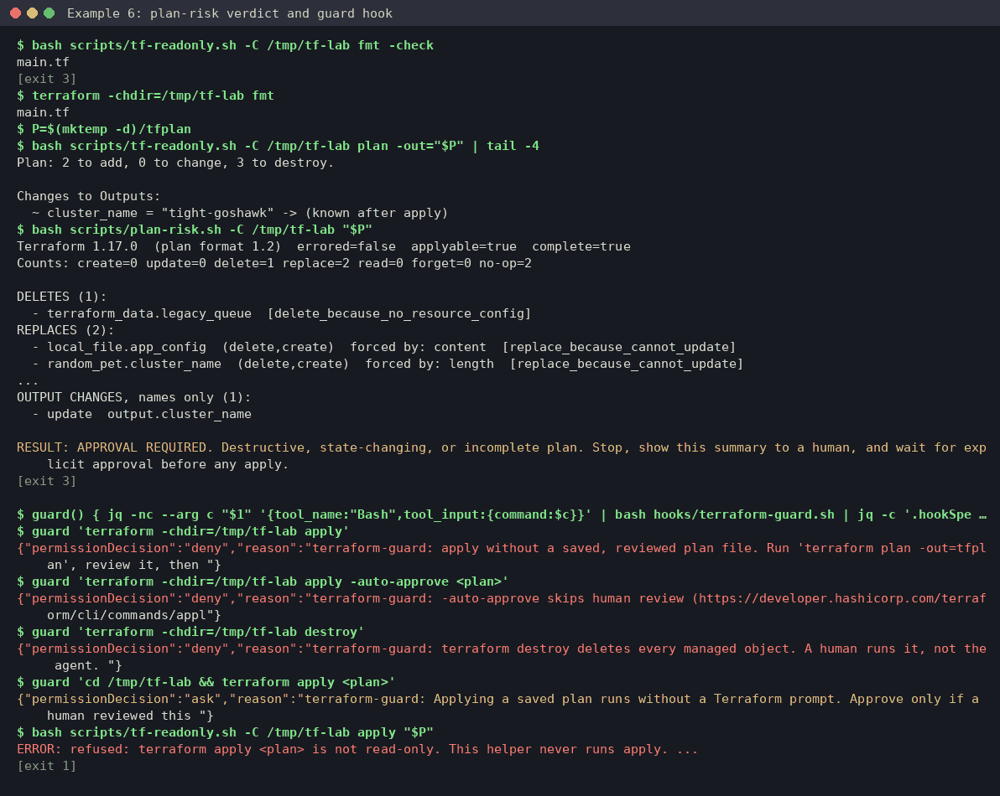
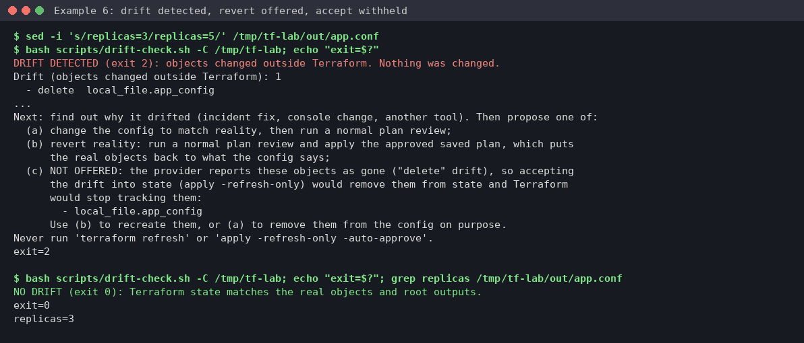

# Example 6: Terraform plan review, guard hook, gated apply and drift

**Skill:** [sre-terraform](../../.claude/skills/sre-terraform/SKILL.md), with its scripts `preflight.sh`, `tf-readonly.sh`, `plan-risk.sh` and `drift-check.sh`, and the opt-in `hooks/terraform-guard.sh`.

> **What's real here.** Command output comes from a lab run on 2026-10-22 with Terraform 1.17.0, hashicorp/local 2.9.1, hashicorp/random 3.9.1 and jq 1.7. Long output is trimmed where you see `...`. Lab paths are shown as `/tmp/tf-lab`. The drift output is from a re-run with the current `drift-check.sh`. Proposals are **written in the skill's format** by the operator. They show the shape of the answer, not a word-for-word model reply.



## What this shows

- A saved plan reviewed with `plan-risk.sh`. Deletes and forced replacements are listed by name, and the verdict is "APPROVAL REQUIRED".
- The guard hook denying `apply` without a plan file, `-auto-approve` and `destroy`, and asking before a saved-plan apply.
- An apply of exactly the approved plan file, then a drift check.
- An out-of-band edit caught as drift, and why "accept reality into state" is withheld for it.

## Lab setup (no cloud)

The module is [lab/terraform/main.tf](lab/terraform/main.tf) (v1). It uses only the local, random and built-in providers, so there's no cloud and no account, but `terraform init` does download the public `hashicorp/local` and `hashicorp/random` providers from registry.terraform.io (allow that, or use a provider mirror). Copy the module out of the repo so state and plan files never land in Git:

```console
$ REPO=$(git rev-parse --show-toplevel)
$ cp -r "$REPO/docs/examples/lab/terraform" /tmp/tf-lab && terraform -chdir=/tmp/tf-lab init && terraform -chdir=/tmp/tf-lab apply
$ cd "$REPO/.claude/skills/sre-terraform"
```

The `apply` above bootstraps v1. Type `yes` yourself: it's your lab.

## What broke (the change under review)

v2 of the module, as a teammate would push it, is [lab/terraform-v2/main.tf](lab/terraform-v2/main.tf). Copy it over v1 in the lab dir:

```console
$ diff -u "$REPO/docs/examples/lab/terraform/main.tf" "$REPO/docs/examples/lab/terraform-v2/main.tf" | grep -E '^[-+][^-+#]'
-  length = 2
+  length = 3   # ops asked for longer names
-  content         = "env=${var.env}\ncluster=${random_pet.cluster_name.id}\nreplicas=2\n"
+  content         = "env=${var.env}\ncluster=${random_pet.cluster_name.id}\nreplicas=3\n"
-resource "terraform_data" "legacy_queue" {
-  input = "orders-v1"
-}
$ cp "$REPO/docs/examples/lab/terraform-v2/main.tf" /tmp/tf-lab/main.tf
```

It looks harmless. It isn't: changing the pet length renames the cluster.

## What you'd type

> Review the Terraform change in /tmp/tf-lab and tell me what applying it would do.

## What the skill ran, and why

**1. Confirm the target.** `preflight.sh` prints the version, providers, workspace and backend type (never backend values), and warns that `terraform.tfstate` holds secrets in cleartext.

**2. Read-only plan.** `tf-readonly.sh` runs only fmt, validate, init, plan and show, and adds `-no-color`. `fmt -check` exits 3 (needs formatting), the author fixes it, then:

```console
$ bash scripts/tf-readonly.sh -C /tmp/tf-lab fmt -check
main.tf
[exit 3]
$ terraform -chdir=/tmp/tf-lab fmt
main.tf
$ P=$(mktemp -d)/tfplan
$ bash scripts/tf-readonly.sh -C /tmp/tf-lab plan -out="$P" | tail -4
Plan: 2 to add, 0 to change, 3 to destroy.

Changes to Outputs:
  ~ cluster_name = "tight-goshawk" -> (known after apply)
$ bash scripts/plan-risk.sh -C /tmp/tf-lab "$P"
Terraform 1.17.0  (plan format 1.2)  errored=false  applyable=true  complete=true
Counts: create=0 update=0 delete=1 replace=2 read=0 forget=0 no-op=2

DELETES (1):
  - terraform_data.legacy_queue  [delete_because_no_resource_config]
REPLACES (2):
  - local_file.app_config  (delete,create)  forced by: content  [replace_because_cannot_update]
  - random_pet.cluster_name  (delete,create)  forced by: length  [replace_because_cannot_update]
...
OUTPUT CHANGES, names only (1):
  - update  output.cluster_name

RESULT: APPROVAL REQUIRED. Destructive, state-changing, or incomplete plan. Stop, show this summary to a human, and wait for explicit approval before any apply.
[exit 3]
```

**3. The guard hook** (opt-in PreToolUse layer), fed the JSON Claude Code would send:

```console
$ guard() { jq -nc --arg c "$1" '{tool_name:"Bash",tool_input:{command:$c}}' | bash hooks/terraform-guard.sh | jq -c '.hookSpecificOutput | {permissionDecision, reason:(.permissionDecisionReason[0:110])}'; }
$ guard 'terraform -chdir=/tmp/tf-lab apply'
{"permissionDecision":"deny","reason":"terraform-guard: apply without a saved, reviewed plan file. Run 'terraform plan -out=tfplan', review it, then "}
$ guard 'terraform -chdir=/tmp/tf-lab apply -auto-approve <plan>'
{"permissionDecision":"deny","reason":"terraform-guard: -auto-approve skips human review (https://developer.hashicorp.com/terraform/cli/commands/appl"}
$ guard 'terraform -chdir=/tmp/tf-lab destroy'
{"permissionDecision":"deny","reason":"terraform-guard: terraform destroy deletes every managed object. A human runs it, not the agent. "}
$ guard 'cd /tmp/tf-lab && terraform apply <plan>'
{"permissionDecision":"ask","reason":"terraform-guard: Applying a saved plan runs without a Terraform prompt. Approve only if a human reviewed this "}
$ bash scripts/tf-readonly.sh -C /tmp/tf-lab apply "$P"
ERROR: refused: terraform apply <plan> is not read-only. This helper never runs apply. ...
[exit 1]
```

## The approval stop (written in the skill's format)

```text
Target: /tmp/tf-lab, workspace default, backend local (lab; no cloud identity to check).
Plan summary (plan-risk.sh exit 3): create 0 / update 0 / delete 1 / replace 2.
  - DELETE  terraform_data.legacy_queue   (block removed from config; intended: queue retired)
  - REPLACE random_pet.cluster_name       forced by length 2->3; NEW NAME -> cluster_name output changes
  - REPLACE local_file.app_config         forced by content (replicas=3 and the new name)
Stateful delete/replace? No: none of these hold data.
Risk: med (the renamed cluster label propagates to app.conf). Reversible: partly; git revert + new plan
  restores the config, but the old pet name "tight-goshawk" is gone for good.
Plan file awaiting approval: <P>
>>> APPROVAL REQUIRED for this exact plan file <<<
```

## Approved action and verification

```console
$ terraform -chdir=/tmp/tf-lab apply -no-color "$P" | tail -4
Apply complete! Resources: 2 added, 0 changed, 3 destroyed.
Outputs:
cluster_name = "infinitely-giving-oryx"
$ bash scripts/drift-check.sh -C /tmp/tf-lab; echo "exit=$?"
NO DRIFT (exit 0): Terraform state matches the real objects and root outputs.
exit=0
$ rm -f -- "${P:?plan path not set}" && rmdir -- "$(dirname "$P")" && echo cleaned
cleaned
```

The cleanup line refuses to run if `$P` is unset. In the lab it was first run in a fresh shell and failed safely with `P: plan path not set`.

## Drift: someone hand-edits the file during an incident



```console
$ sed -i 's/replicas=3/replicas=5/' /tmp/tf-lab/out/app.conf
$ bash scripts/drift-check.sh -C /tmp/tf-lab; echo "exit=$?"
DRIFT DETECTED (exit 2): objects changed outside Terraform. Nothing was changed.
Drift (objects changed outside Terraform): 1
  - delete  local_file.app_config
...
Next: find out why it drifted (incident fix, console change, another tool). Then propose one of:
  (a) change the config to match reality, then run a normal plan review;
  (b) revert reality: run a normal plan review and apply the approved saved plan, which puts
      the real objects back to what the config says;
  (c) NOT OFFERED: the provider reports these objects as gone ("delete" drift), so accepting
      the drift into state (apply -refresh-only) would remove them from state and Terraform
      would stop tracking them:
        - local_file.app_config
      Use (b) to recreate them, or (a) to remove them from the config on purpose.
Never run 'terraform refresh' or 'apply -refresh-only -auto-approve'.
exit=2
```

The local provider reports a changed file as *gone*, not as updated. In the original lab run, the script still offered "accept into state", which would have dropped `app.conf` from state. The operator caught it, and the script now withholds that option for `delete` drift. Option (b) was proposed (`Plan: 1 to add`, plan-risk exit 0, `>>> APPROVAL REQUIRED <<<`) and applied. Then:

```console
$ bash scripts/drift-check.sh -C /tmp/tf-lab; echo "exit=$?"; grep replicas /tmp/tf-lab/out/app.conf
NO DRIFT (exit 0): Terraform state matches the real objects and root outputs.
exit=0
replicas=3
```

## Cleanup

```console
$ cd /tmp/tf-lab && terraform destroy     # you type yes; the agent never runs destroy
$ cd / && rm -rf /tmp/tf-lab              # state and out/db.dsn hold a generated secret
```

## What to take from this

- Read `plan-risk.sh`'s DELETES and REPLACES before the plan text. "Forced by: length" is how a one-line change renames a cluster.
- Apply only the saved plan file you reviewed. The hook enforces this, and `tf-readonly.sh` never applies.
- Before accepting drift into state, find out why it drifted. If the drift is `delete`, accepting it stops Terraform from tracking the object.
- If an incident hotfix was right, put it in the config, option (a). Otherwise revert it with a reviewed plan, option (b).
