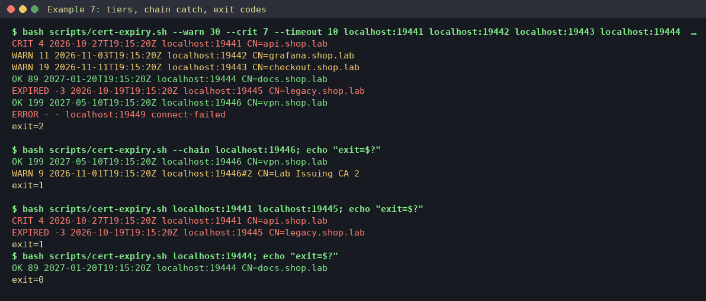

# Example 7: TLS expiry audit, endpoints and files sorted into tiers

**Skill:** [sre-expiry-audit](../../.claude/skills/sre-expiry-audit/SKILL.md), with `scripts/cert-expiry.sh`.

> **What's real here.** Command output comes from a lab run on 2026-10-22 with OpenSSL 3.5.7 (`openssl s_server` endpoints) and bash 5. The output shown is from a re-run of this page with the current `cert-expiry.sh`; the temporary directory is shown as `/tmp/tmp.XXXXXXXXXX`. The "before the fix" block is from the first run. The audit table is **written in the skill's format** by the operator. It shows the shape of the answer, not a word-for-word model reply. After the run the lab ports moved below the Linux ephemeral range (now 19441-19449 and 18441-18445) so they can't collide with outgoing connections; the port numbers are the only change to the output, and setup, a query on each port and teardown were re-checked.



## What this shows

- One run sorting endpoints into the skill's tiers: EXPIRED, 7 days, 14 days, 30 days and OK.
- The chain catch: a leaf that's fine for 199 days, behind an intermediate that dies in 9.
- Exit codes you can script on: 0 all OK, 1 something inside a window, 2 something couldn't be checked.
- A bug this lab found and that's now fixed: expired endpoints used to exit 0.

## Lab setup (OpenSSL only)

[lab/expiry/mk-certs.sh](lab/expiry/mk-certs.sh) makes a private root CA, a 10-day intermediate, and six leaf certs: api (5 days), grafana (12), checkout (20), docs (90), legacy (expired 3 days ago) and vpn (200, issued by the intermediate). Run it in a temporary directory (`$LAB`, used again below), then serve each cert on a loopback port:

```console
$ REPO=$(git rev-parse --show-toplevel); LAB=$(mktemp -d)
$ cd "$LAB" && bash "$REPO/docs/examples/lab/expiry/mk-certs.sh"
$ p=19441; for n in api grafana checkout docs legacy; do openssl s_server -accept $p -cert $n.pem -key $n.key -www -quiet >/dev/null 2>&1 & p=$((p+1)); done
$ openssl s_server -accept 19446 -cert vpn.pem -cert_chain inter.pem -key vpn.key -www -quiet >/dev/null 2>&1 &
```

Port 19449 is left closed on purpose. Then go to the skill, where the commands below run:

```console
$ cd "$REPO/.claude/skills/sre-expiry-audit"
```

## What broke

Nothing has failed yet. Expiry is the outage you can see coming. One cert has already expired, one expires this week, and an intermediate CA quietly expires before the leaf it signs.

## What you'd type

> Audit TLS expiry for localhost:19441 to 19446 and 19449, including chains. Use 30/14/7-day tiers.

## What the skill ran, and why

**1. All endpoints, leaf certificates, explicit thresholds.** Each row gives the status, days left, the expiry in UTC, the target and the subject:

```console
$ bash scripts/cert-expiry.sh --warn 30 --crit 7 --timeout 10 localhost:19441 localhost:19442 localhost:19443 localhost:19444 localhost:19445 localhost:19446 localhost:19449; echo "exit=$?"
CRIT 4 2026-10-27T19:15:20Z localhost:19441 CN=api.shop.lab
WARN 11 2026-11-03T19:15:20Z localhost:19442 CN=grafana.shop.lab
WARN 19 2026-11-11T19:15:20Z localhost:19443 CN=checkout.shop.lab
OK 89 2027-01-20T19:15:20Z localhost:19444 CN=docs.shop.lab
EXPIRED -3 2026-10-19T19:15:20Z localhost:19445 CN=legacy.shop.lab
OK 199 2027-05-10T19:15:20Z localhost:19446 CN=vpn.shop.lab
ERROR - - localhost:19449 connect-failed
exit=2
```

Exit 2 means at least one target couldn't be checked, and that outranks the CRIT. "Could not check" must never read as "fine". Without the closed port, the same run exits 1.

**2. The chain.** A leaf-only scan says vpn is fine for 199 days. `--chain` checks every certificate the server sends:

```console
$ bash scripts/cert-expiry.sh --chain localhost:19446; echo "exit=$?"
OK 199 2027-05-10T19:15:20Z localhost:19446 CN=vpn.shop.lab
WARN 9 2026-11-01T19:15:20Z localhost:19446#2 CN=Lab Issuing CA 2
exit=1
```

**3. Files work the same way**, for certs sitting in a repo or on disk before they're deployed:

```console
$ bash scripts/cert-expiry.sh --chain --file "$LAB/vpn-chain.pem"; echo "exit=$?"
OK 199 2027-05-10T19:15:20Z /tmp/tmp.XXXXXXXXXX/vpn-chain.pem CN=vpn.shop.lab
WARN 9 2026-11-01T19:15:20Z /tmp/tmp.XXXXXXXXXX/vpn-chain.pem#2 CN=Lab Issuing CA 2
exit=1
$ bash scripts/cert-expiry.sh --file "$LAB/api.pem" "$LAB/legacy.pem" "$LAB/docs.pem"; echo "exit=$?"
CRIT 4 2026-10-27T19:15:20Z /tmp/tmp.XXXXXXXXXX/api.pem CN=api.shop.lab
EXPIRED -3 2026-10-19T19:15:20Z /tmp/tmp.XXXXXXXXXX/legacy.pem CN=legacy.shop.lab
OK 89 2027-01-20T19:15:20Z /tmp/tmp.XXXXXXXXXX/docs.pem CN=docs.shop.lab
exit=1
```

## The bug this lab caught (now fixed)

In the first lab run, an expired endpoint plus a CRIT endpoint exited **0**:

```console
$ bash scripts/cert-expiry.sh localhost:18441 localhost:18445; echo "exit=$?"    # before the fix
CRIT 4 2026-10-27T18:18:06Z localhost:18441 CN=api.shop.lab
EXPIRED -3 2026-10-19T12:00:00Z localhost:18445 CN=legacy.shop.lab
exit=0
```

The script piped each endpoint's PEM into the function that set the exit code. In bash, the right side of a pipe runs in a subshell, so that exit code was lost. Any cron job or CI gate using the exit code would have stayed green. After the fix:

```console
$ bash scripts/cert-expiry.sh localhost:19441 localhost:19445; echo "exit=$?"
CRIT 4 2026-10-27T19:15:20Z localhost:19441 CN=api.shop.lab
EXPIRED -3 2026-10-19T19:15:20Z localhost:19445 CN=legacy.shop.lab
exit=1
$ bash scripts/cert-expiry.sh localhost:19444; echo "exit=$?"
OK 89 2027-01-20T19:15:20Z localhost:19444 CN=docs.shop.lab
exit=0
```

The bundled tests (`bash scripts/tests/run_tests.sh`) now cover endpoint exit codes and multi-file `--file`.

## The report (written in the skill's format)

```text
Scope checked: 7 lab endpoints localhost:19441-19446 (+19449), leaf and --chain; 1 chain file.
Not checked: domains, Kubernetes, cloud (out of lab scope). 1 endpoint could not be checked: localhost:19449.
| tier    | days | expires (UTC)        | item                          | where             | next step                             |
| EXPIRED | -3   | 2026-10-19T19:15:20Z | CN=legacy.shop.lab            | localhost:19445   | renew now or decommission             |
| 7d      | 4    | 2026-10-27T19:15:20Z | CN=api.shop.lab               | localhost:19441   | page-worthy: re-issue today           |
| 14d     | 9    | 2026-11-01T19:15:20Z | CN=Lab Issuing CA 2 (interm.) | localhost:19446#2 | re-issue intermediate; the vpn leaf   |
|         |      |                      |                               |                   | (199 d) breaks with it                |
| 14d     | 11   | 2026-11-03T19:15:20Z | CN=grafana.shop.lab           | localhost:19442   | renew this week                       |
| 30d     | 19   | 2026-11-11T19:15:20Z | CN=checkout.shop.lab          | localhost:19443   | plan renewal                          |
| ERROR   | -    | -                    | localhost:19449               | -                 | connect-failed: verify the target     |
ok: 2 (docs 89 d, vpn leaf 199 d). Owners and auto-renew: fill in from your inventory.
Renewals are separate gated changes (sre-change-safety); nothing was renewed.
```

## The approval stop

This skill is read-only from start to finish. It never renews, re-issues or deploys a certificate. Each renewal in the table becomes its own change, with a proposal and your approval, through [sre-change-safety](../../.claude/skills/sre-change-safety/SKILL.md). In this lab, nothing was renewed, so there's no approved action to show.

## Cleanup

```console
$ kill $(jobs -p); cd "$REPO" && rm -rf "$LAB"    # the directory holds private keys
```

## What to take from this

- Always scan with `--chain`. Intermediates expire too, and a leaf-only scan reports them as healthy.
- Script on the exit code: 1 means act, 2 means you're blind somewhere. Both should fail a CI or cron check.
- Check files before they ship, not only live endpoints.
- If a check tool exits 0, test it once against something you know is expired. That's how this bug was found.
