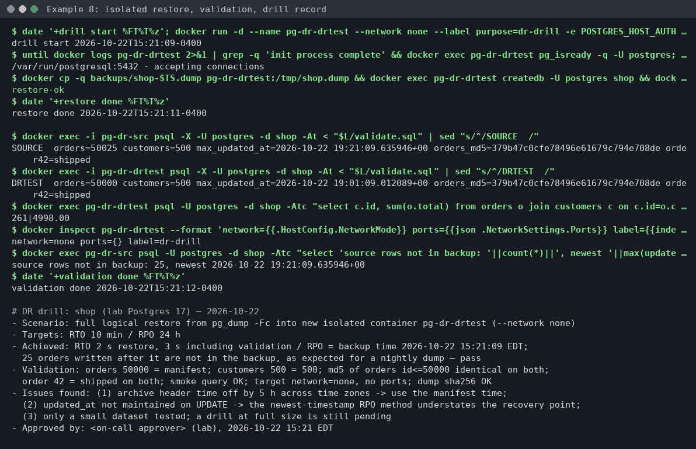

# Example 8: a DR restore drill, timed and validated against RTO and RPO

**Skill:** [sre-dr-backup-test](../../.claude/skills/sre-dr-backup-test/SKILL.md), workflow steps 1 to 8 and its drill-record template.

> **What's real here.** Every command and its output below comes from one run of this page, top to bottom, on 2026-10-22 with PostgreSQL 17.11 (`postgres:17`; host pg_restore 17.11) in Docker 26, on a host in America/Detroit (EDT). The temporary directory is shown as `/tmp/tmp.XXXXXXXXXX`. The scope, plan and drill record are **written in the skill's format** by the operator. They show the shape of the answer, not a word-for-word model reply.



## What this shows

- A drill restores into a **new, isolated** target, never over the source.
- Validation goes beyond "the restore exited 0": counts against the manifest, a checksum of the rows, a known record and an app-style query.
- Two honest findings: the archive header's timestamp was wrong by hours, and the "newest row" method understated the recovery point.
- Cleanup is gated too, and checks a name and a label before deleting anything.

The skill's own restore commands cover AWS, Azure, GCP and Velero. This lab applies the same workflow to a self-managed Postgres, with `pg_dump -Fc` as the "backup system".

## Lab setup (Docker and a host pg_restore)

[lab/dr-drill/setup.sh](lab/dr-drill/setup.sh) starts the source, container `pg-dr-src`, with `--network none`: it has no ports and is reachable only through `docker exec`, so it needs no passwords. It loads the same `shop` data as example 2 ([seed.sql](lab/postgres/seed.sql)), then stands in for real app history: every order was last written 20 minutes ago, and order 42 was later marked shipped by code that doesn't touch `updated_at`. Run from anywhere inside your clone:

```console
$ REPO=$(git rev-parse --show-toplevel); L=$REPO/docs/examples/lab/dr-drill
$ LAB=$(mktemp -d)
$ bash "$L/setup.sh" "$LAB" && cd "$LAB"
pg-dr-src ready (no network; lab files in /tmp/tmp.XXXXXXXXXX)
```

Take the "nightly" backup with a checksum and a manifest that records the real backup time:

```console
$ TS=$(date -u +%Y%m%dT%H%M%SZ)
$ docker exec pg-dr-src pg_dump -U postgres -Fc -d shop -f /tmp/shop.dump && docker cp -q pg-dr-src:/tmp/shop.dump backups/shop-$TS.dump
$ (cd backups && sha256sum shop-$TS.dump > shop-$TS.dump.sha256)
$ docker exec pg-dr-src psql -U postgres -d shop -Atc "select 'orders='||count(*)||' customers='||(select count(*) from customers)||' max_updated_at='||max(updated_at)||' taken_at='||now() from orders" | tee backups/shop-$TS.manifest
orders=50000 customers=500 max_updated_at=2026-10-22 19:01:09.012089+00 taken_at=2026-10-22 19:21:09.525582+00
```

Then, after the backup, the app writes 25 more orders, which the backup can't contain:

```console
$ docker exec pg-dr-src psql -U postgres -d shop -c "insert into orders select g, 1+g%500, 'new', 19.99, now() from generate_series(50001,50025) g"
INSERT 0 25
```

## What broke

Nothing yet, and that's the point. A backup you've never restored is a hope, not a backup. The drill shows whether you can meet the targets: RTO 10 minutes and RPO 24 hours.

## What you'd type

> Run a restore drill for the shop Postgres from the latest pg_dump in backups/. Targets: RTO 10 min, RPO 24 h.

## What the skill ran, and why

**1-2. Scope and inventory, read-only.** Is the backup there, intact and what we think it is?

```console
$ (cd backups && sha256sum -c ./*.sha256 && cat ./*.manifest)
shop-20261022T192109Z.dump: OK
orders=50000 customers=500 max_updated_at=2026-10-22 19:01:09.012089+00 taken_at=2026-10-22 19:21:09.525582+00
$ pg_restore -l backups/shop-*.dump | grep -E 'TABLE DATA|Archive|Format|Dumped from'
; Archive created at 2026-10-22 20:21:09 EDT
;     Format: CUSTOM
;     Dumped from database version: 17.11 (Debian 17.11-1.pgdg13+2)
3428; 0 16386 TABLE DATA public customers shop
3429; 0 16393 TABLE DATA public orders shop
```

The header says 20:21 EDT, but the dump ran at 19:21:09 UTC (15:21 EDT, the manifest's `taken_at`): five hours off. pg_dump ran in a UTC container and the header stores a zone-less local time, which the host's pg_restore then reads as local standard time. Take the backup time from the manifest or object metadata, not the archive header.

## The approval stop (written in the skill's format)

```text
Restore type: full DB (logical) from shop-<ts>.dump to a NEW container pg-dr-drtest
  - docker run --network none (can't receive prod traffic or reach prod), no published ports,
    label purpose=dr-drill; never touches pg-dr-src.
Validation: row counts vs the manifest; md5 of all orders rows (id <= 50000) vs source; order 42;
  newest updated_at; app-style smoke query (top customer by spend).
Cleanup: docker rm -f only if the name ends in -drtest AND label purpose=dr-drill (after approval).
Risk: low (new isolated target). Reversible: yes (delete the drill container).
>>> APPROVAL REQUIRED: restore to pg-dr-drtest <<<
```

## Approved action: restore (the timer starts)

```console
$ date '+drill start %FT%T%z'; docker run -d --name pg-dr-drtest --network none --label purpose=dr-drill -e POSTGRES_HOST_AUTH_METHOD=trust postgres:17 >/dev/null
drill start 2026-10-22T15:21:09-0400
$ until docker logs pg-dr-drtest 2>&1 | grep -q 'init process complete' && docker exec pg-dr-drtest pg_isready -q -U postgres; do sleep 1; done; docker exec pg-dr-drtest pg_isready -U postgres
/var/run/postgresql:5432 - accepting connections
$ docker cp -q backups/shop-$TS.dump pg-dr-drtest:/tmp/shop.dump && docker exec pg-dr-drtest createdb -U postgres shop && docker exec pg-dr-drtest pg_restore -U postgres -d shop --no-owner --exit-on-error /tmp/shop.dump && echo restore-ok
restore-ok
$ date '+restore done %FT%T%z'
restore done 2026-10-22T15:21:11-0400
```

Trust auth is acceptable only because the container has no network at all.

## Verification

The same query, [validate.sql](lab/dr-drill/validate.sql), runs on the source and on the restore. It builds one line with the counts, the newest `updated_at`, an md5 over `id:customer_id:status:total` for every backed-up order (`id <= 50000`), and order 42's status:

```sql
-- Validation for docs/examples/08: run on the source and on the restore, compare the lines.
-- Counts, newest updated_at, md5 over every backed-up order (id <= 50000), and one known record.
SELECT 'orders=' || (SELECT count(*) FROM orders)
    || ' customers=' || (SELECT count(*) FROM customers)
    || ' max_updated_at=' || (SELECT max(updated_at) FROM orders)
    || ' orders_md5=' || (SELECT md5(string_agg(id || ':' || customer_id || ':' || status || ':' || total, ',' ORDER BY id))
                          FROM orders WHERE id <= 50000)
    || ' order42=' || (SELECT status FROM orders WHERE id = 42);
```

```console
$ docker exec -i pg-dr-src psql -X -U postgres -d shop -At < "$L/validate.sql" | sed "s/^/SOURCE  /"
SOURCE  orders=50025 customers=500 max_updated_at=2026-10-22 19:21:09.635946+00 orders_md5=379b47c0cfe78496e61679c794e708de order42=shipped
$ docker exec -i pg-dr-drtest psql -X -U postgres -d shop -At < "$L/validate.sql" | sed "s/^/DRTEST  /"
DRTEST  orders=50000 customers=500 max_updated_at=2026-10-22 19:01:09.012089+00 orders_md5=379b47c0cfe78496e61679c794e708de order42=shipped
$ docker exec pg-dr-drtest psql -U postgres -d shop -Atc "select c.id, sum(o.total) from orders o join customers c on c.id=o.customer_id group by 1 order by 2 desc limit 1"
261|4998.00
$ docker inspect pg-dr-drtest --format 'network={{.HostConfig.NetworkMode}} ports={{json .NetworkSettings.Ports}} label={{index .Config.Labels "purpose"}}'
network=none ports={} label=dr-drill
$ docker exec pg-dr-src psql -U postgres -d shop -Atc "select 'source rows not in backup: '||count(*)||', newest '||max(updated_at) from orders where id>50000"
source rows not in backup: 25, newest 2026-10-22 19:21:09.635946+00
$ date '+validation done %FT%T%z'
validation done 2026-10-22T15:21:12-0400
```

The md5 matches, and the 25 missing rows are exactly the ones written after the backup. The newest `updated_at` in the restore is 19:01 UTC, 20 minutes older than the real backup time (19:21 UTC). Order 42's later change didn't bump `updated_at`. So "newest timestamp" understates the recovery point here. The real recovery point is the backup time, which the checksum confirms.

## The drill record (written in the skill's format, from the SKILL.md template)

```text
# DR drill: shop (lab Postgres 17) — 2026-10-22
- Scenario: full logical restore from pg_dump -Fc into new isolated container pg-dr-drtest (--network none)
- Targets: RTO 10 min / RPO 24 h
- Achieved: RTO 2 s restore, 3 s including validation / RPO = backup time 2026-10-22 15:21:09 EDT;
  25 orders written after it are not in the backup, as expected for a nightly dump — pass
- Validation: orders 50000 = manifest; customers 500 = 500; md5 of orders id<=50000 identical on both;
  order 42 = shipped on both; smoke query OK; target network=none, no ports; dump sha256 OK
- Issues found: (1) archive header time off by 5 h across time zones -> use the manifest time;
  (2) updated_at not maintained on UPDATE -> the newest-timestamp RPO method understates the recovery point;
  (3) only a small dataset tested; a drill at full size is still pending
- Approved by: <on-call approver> (lab), 2026-10-22 15:21 EDT
```

## Cleanup (gated, with a guard)

```console
$ n=pg-dr-drtest; [[ $n == *-drtest ]] && [[ $(docker inspect -f '{{index .Config.Labels "purpose"}}' $n) == dr-drill ]] && docker rm -f $n
pg-dr-drtest
$ docker ps -a --format '{{.Names}}' | grep -c drtest; docker ps --format '{{.Names}} {{.Status}}' | grep pg-dr
0
pg-dr-src Up 5 seconds
```

The source is untouched. When you're done, `teardown.sh` removes it and deletes the lab directory with the backups:

```console
$ cd "$REPO" && bash "$L/teardown.sh" "$LAB"
pg-dr-src removed
```

## What to take from this

- Restore into something new and isolated (`--network none` here). A drill must never be able to touch production.
- "Restore succeeded" isn't validation. Compare counts, a checksum, a known record and a real query against the source.
- Measure RTO from your own timestamps, and RPO from the backup's real time. Don't trust archive headers or `updated_at`.
- Write the record even when the drill passes. The issues list is what improves the next drill.
