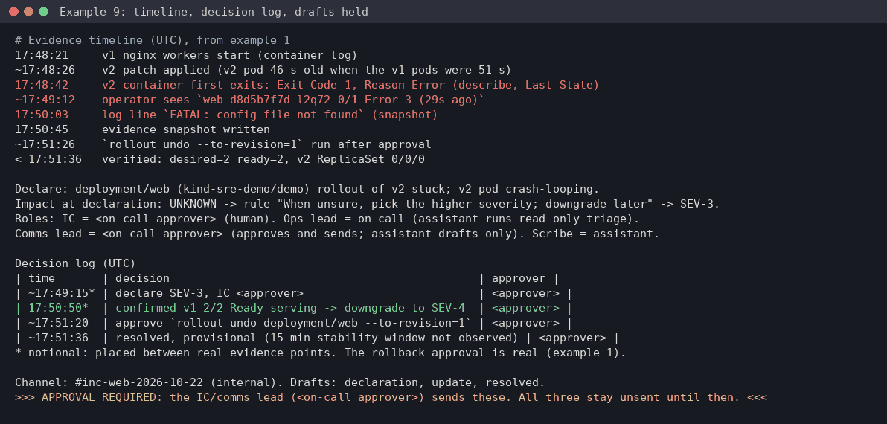

# Example 9: the incident lifecycle on paper, from declaration to postmortem

**Skills:** [sre-incident-command](../../.claude/skills/sre-incident-command/SKILL.md), then [sre-incident-communication](../../.claude/skills/sre-incident-communication/SKILL.md), then [sre-postmortem-templates](../../.claude/skills/sre-postmortem-templates/SKILL.md).

> **What's real here.** The evidence and its timestamps come from the real lab run in [example 1](01-k8s-crashloop-rollback.md) (kind v0.31.0, node v1.35.0, 2026-10-22). Times marked `~` are worked out from pod ages, not read directly. Everything else on this page (the decision log, the three updates, the postmortem) is **written in the skill's format** by the operator. Nothing was sent or published.



## What this shows

- Running the human side of the incident from example 1: severity, roles, a decision log, updates and a postmortem.
- Every time traced to evidence, with derived times marked as such.
- Drafts only: the assistant writes updates and the postmortem, and you approve and send them.
- Gaps called out honestly (no 15-minute stability window, owners still TBD) instead of papered over.

## Lab setup

Run [example 1](01-k8s-crashloop-rollback.md). No other setup: the inputs are its transcript and evidence snapshot. Times are UTC, as the skills ask (EDT = UTC-4).

## What broke

Revision 2 of `deployment/web` crash-looped (`FATAL: config file not found`). The two v1 pods kept serving. It was rolled back after approval.

## What you'd type

> I'm IC for the web rollout incident on kind-sre-demo. Keep the decision log, draft the internal updates, and draft the postmortem from the evidence. Don't send anything.

## Step 1: build the timeline from evidence

| Time (UTC) | Evidence from example 1 |
|---|---|
| 17:48:21 | v1 nginx workers start (container log) |
| ~17:48:26 | v2 patch applied (v2 pod 46 s old when the v1 pods were 51 s) |
| 17:48:42 | v2 container first exits: Exit Code 1, Reason Error (describe, Last State) |
| ~17:49:12 | operator sees `web-d8d5b7f7d-l2q72 0/1 Error 3 (29s ago)` |
| 17:50:03 | log line `FATAL: config file not found` (snapshot) |
| 17:50:45 | evidence snapshot written |
| ~17:51:26 | `rollout undo --to-revision=1` run after approval |
| < 17:51:36 | verified: desired=2 ready=2, v2 ReplicaSet 0/0/0 |

## Step 2: declare and log decisions (sre-incident-command)

```text
Declare: deployment/web (kind-sre-demo/demo) rollout of v2 stuck; v2 pod crash-looping.
Impact at declaration: UNKNOWN -> rule "When unsure, pick the higher severity; downgrade later" -> SEV-3.
Roles: IC = <on-call approver> (human). Ops lead = on-call (assistant runs read-only triage).
Comms lead = <on-call approver> (approves and sends; assistant drafts only). Scribe = assistant.

Decision log (UTC)
| time       | decision                                              | approver |
| ~17:49:15* | declare SEV-3, IC <approver>                          | <approver> |
| 17:50:50*  | confirmed v1 2/2 Ready serving -> downgrade to SEV-4  | <approver> |
| ~17:51:20  | approve `rollout undo deployment/web --to-revision=1` | <approver> |
| ~17:51:36  | resolved, provisional (15-min stability window not observed) | <approver> |
* notional: placed between real evidence points. The rollback approval is real (example 1).
```

## Step 3: the updates, drafted and held (sre-incident-communication)

Internal channel only. SEV-4 has no external post, so there's no status-page draft.

```markdown
🔄 **INCIDENT UPDATE** (17:51 UTC)
**Current Status:** Identified
**Severity:** SEV-4 (downgraded from SEV-3: confirmed no user impact)
**Impact:** None for users: 2/2 v1 pods Ready and serving; deploy of v2 blocked at 1/2 updated
**Actions Taken:** Captured evidence (snapshot 17:50:45 UTC); cause found: v2 entrypoint exits 1 ("FATAL: config file not found"); rollback to revision 1 proposed, awaiting IC approval
**Next Update:** On status change (SEV-4 cadence)
```

```markdown
✅ **INCIDENT RESOLVED**
**Service:** web (kind-sre-demo / demo)
**Resolution Time:** 17:51:36 UTC
**Summary:** Rolled deployment/web back to revision 1 (approved by IC); 2/2 Ready, v2 ReplicaSet scaled to 0, no new BackOff events.
**Follow-up:** A blameless postmortem will be scheduled within 48 hours of resolution.
```

The declaration message (SEV-3, impact `[TBD]`, next update 17:51 UTC) follows the same template.

## The approval stop

```text
Channel: #inc-web-2026-10-22 (internal). Drafts: declaration, update, resolved.
>>> APPROVAL REQUIRED: the IC/comms lead (<on-call approver>) sends these. All three stay unsent until then. <<<
```

The assistant never posts to Slack, a status page or email itself. The same rule covers the postmortem: it's a draft until someone approves publishing it.

## Step 4: the postmortem draft (sre-postmortem-templates, headings verbatim)

```markdown
# Postmortem: web v2 rollout crash-loop on kind-sre-demo
**Date:** 2026-10-22   **Severity:** SEV-4 (declared SEV-3, downgraded 17:50:50 UTC)   **IC:** <on-call approver>

## 1. Summary
Revision 2 changed the container entrypoint to a command that exits 1 when its config file is missing,
so the new pod crash-looped and the rollout stalled at 1/2. maxUnavailable 25% of 2 rounds down to 0,
so both v1 pods kept serving. The IC approved a rollback; 2/2 Ready about 3 minutes after the first crash.

## 2. Impact
- **User Impact:** None observed (no readiness probe defined, see action items)
- **Duration:** ~2 min 54 s (17:48:42 first crash to ~17:51:36 verified)
- **TTD:** ~30 s by a human watching `get pods`; no alert fired (none exists for stuck rollouts)
- **TTM:** ~2 min 44 s (17:48:42 -> ~17:51:26 rollback)
- **SLO Impact:** None measurable (no metrics on the lab cluster)

## 4. Root Cause Analysis (The Five Whys)
1. Rollout stuck? The v2 pod never became Ready; it exited 1 on every start.
2. Exit 1? The new entrypoint needs /etc/web/app.conf, which the pod spec doesn't mount.
3. Shipped without it? The entrypoint change and the mount weren't reviewed or tested together.
4. Not stopped earlier? No pre-deploy check (staging smoke test) for entrypoint changes.
5. Found by a human? No alert on stuck rollouts or restart counts.

## 6. Where did we get lucky?
- replicas=2 with 25% maxUnavailable rounds to 0; with 4+ replicas a v1 pod would have gone down

## 7. Action Items
| Action | Type | Owner | Due date | Ticket | Status |
|---|---|---|---|---|---|
| Add a readinessProbe to deployment/web | Prevent | web owner [TBD] | 2026-10-29 | [TICKET-TBD-1] | Open |
| Alert on stuck rollouts (progressDeadlineSeconds) and restart rate | Detect | SRE on-call [TBD] | 2026-10-29 | [TICKET-TBD-2] | Open |
| Ship entrypoint changes with their config; staging smoke test | Prevent | web owner [TBD] | 2026-11-05 | [TICKET-TBD-3] | Open |
| Set maxUnavailable: 0 explicitly | Mitigate | web owner [TBD] | 2026-10-29 | [TICKET-TBD-4] | Open |
```

Sections 3 (timeline, from step 1) and 5 (what went well) are in the full draft, and omitted here for length.

## Verification

- Each time in the postmortem maps to a row in step 1. Derived times keep their `~`.
- The headings and field names match the template in sre-postmortem-templates.
- Open questions are listed, not hidden: the 15-minute stability window wasn't observed, the derived times need checking against API server audit logs, and owners and ticket IDs are `[TBD]`.

## Cleanup

Nothing to clean up: nothing was sent, posted or filed. Delete the drafts if you don't need them.

## What to take from this

- Declare high when unsure, and downgrade once you have evidence. The decision log records both.
- Write the timeline from evidence and mark derived times. A postmortem with invented precision is worse than one with `~`.
- The assistant drafts, and a human sends. Updates and postmortems go out under your name.
- "Where did we get lucky?" is the most useful section here: a rounding rule was the only thing keeping v1 up.
